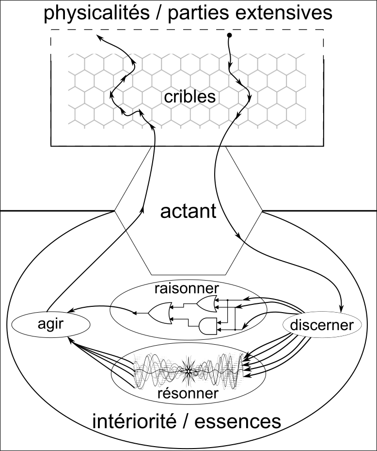
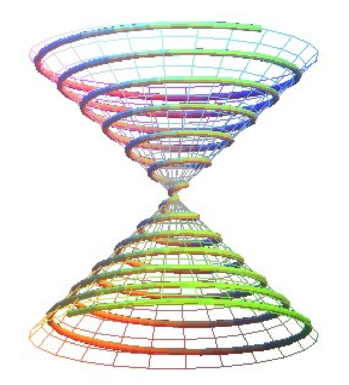
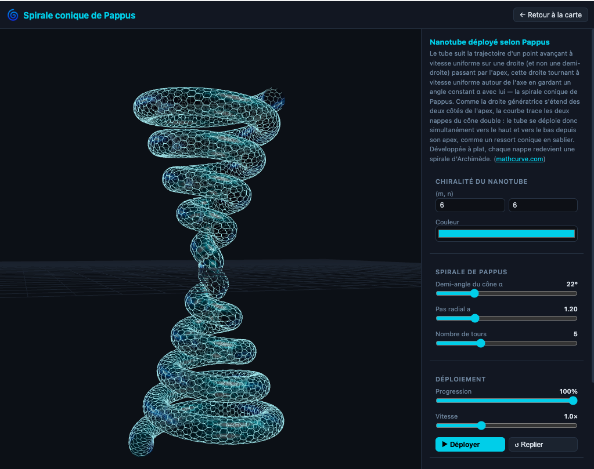
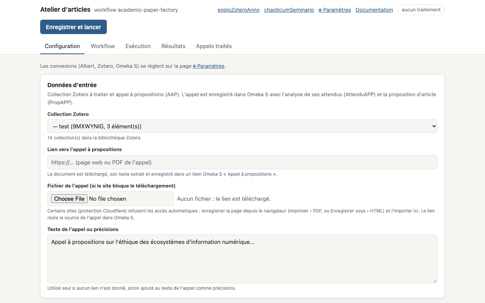
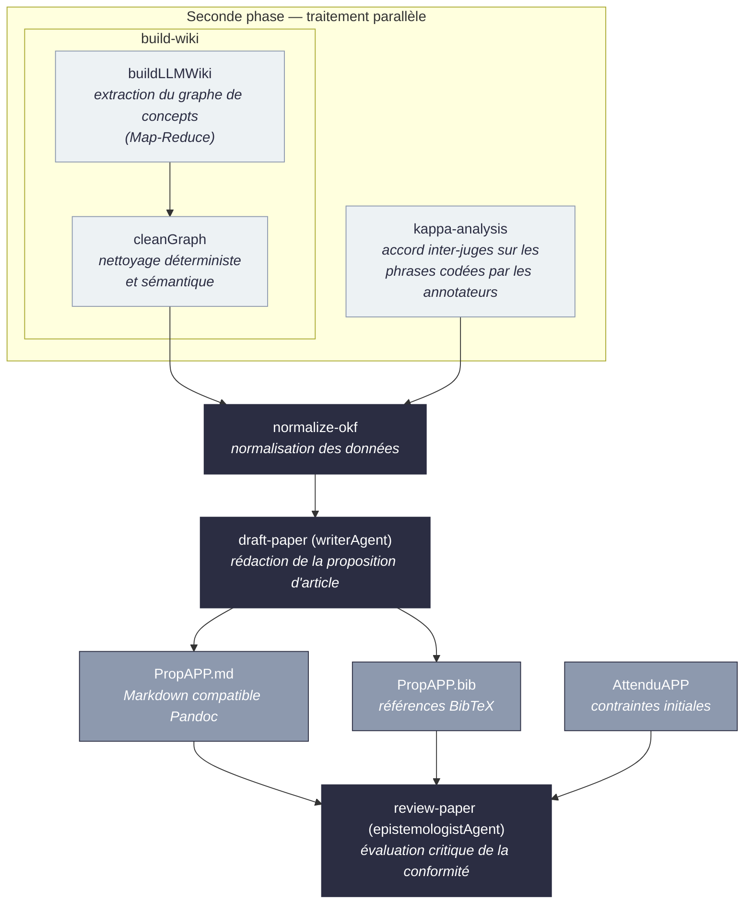
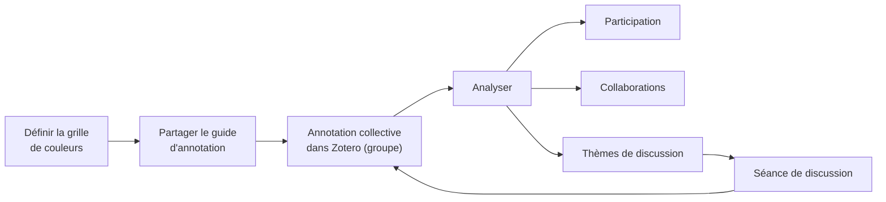
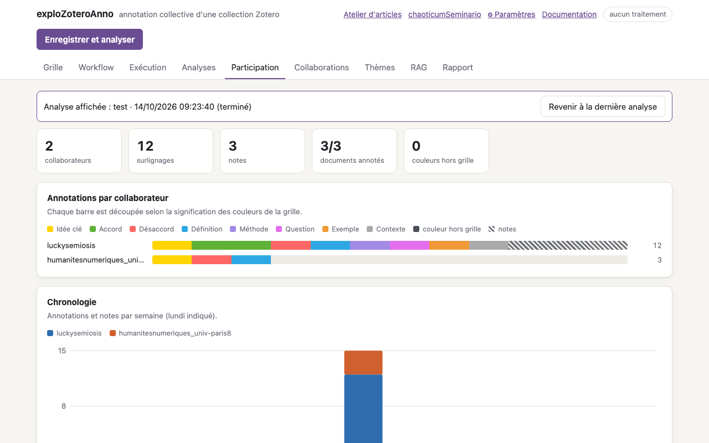
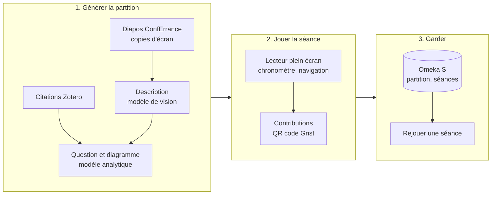

# Habiter les écosystèmes hybrides : design des intelligences collectives, artificielles et environnementales

## Introduction

Cette contribution[^1] examine les mutations contemporaines des rapports que nous entretenons dans les écosystèmes hybrides composés d'humains, d'agents numériques et d'environnements info-communicationnels. D’une part, les innovations technologiques et la numérisation des activités de service favorisent un confort, notamment cognitif, qui participe d'une déterritorialisation des pratiques socioprofessionnelles et économiques [@deleuze1972a; @castells1996a]. D’autre part, cette émancipation spatiale suscite en réaction une exigence accrue d'ancrage physique, corporel et environnemental. Cette dynamique paradoxale engage une reterritorialisation « augmentée » et personnalisée, au sein de laquelle le territoire et l'environnement sont réinvestis d'une dimension éthique et symbolique vitale [@latour2017]. Dès lors, concevoir, habiter et préserver ces écosystèmes hybrides exige la mobilisation de formes renouvelées d’intelligence partagée et distribuée, capables d'articuler ancrage environnemental, médiations technologiques et agentivité du vivant [@ingold2011; @mancuso2018].

[^1]: Ce texte a été conçu en collaboration avec l'IA [Gemini Notebook](https://notebook.google.com/) : <https://notebook.google.com/notebook/a482e063-b116-4b28-9239-9242ad30e741>

    L'historique des versions est consultable ici : <https://github.com/samszo/publications/commits/main/01%20Design%2013/HabiterEcosystemesHybrides.qmd>

Une démarche onto-éthique considère comme indissociables l’ordre de l’être (l'ontologie) et l’ordre de l’action (l'éthique). Appliquée au design et aux écosystèmes hybrides, elle pose comme préalable épistémologique la reconnaissance d’une agentivité et d’une valeur intrinsèque aux entités non-humaines — qu'il s'agisse des végétaux, des milieux associés ou des dispositifs numériques. L’éthique ne s’ajoute plus sous la forme d'un ensemble de prescriptions morales a posteriori ; elle s'inscrit au cœur même de la structure du modèle de conception : la manière dont nous définissons la réalité des sujets (ce qu'ils sont) dicte rigoureusement la manière dont nous interagissons avec eux (ce que nous nous autorisons à faire). Intégrer par exemple l'environnement dans un écosystème hybride impose dès lors d'élargir nos représentations de l'intellection et de la technique. Dans ce cadre, l'intellection environnementale ne relève pas d'une conscience centrale ou réflexive, mais d'une cognition distribuée, fondée sur le traitement continu de données biologiques et sur des prises de décision morphologiques par lesquelles le vivant s'adapte dynamiquement à son milieu [@marder2013; @mancuso2018a]. Par exemple, le végétal n'est pas extérieur à la sphère technique : il déploie une technicité propre à travers ses facultés d'ingénierie environnementale, de plasticité tissulaire et de signalisation biophysique [@simondon1958].

Dans une démarche onto-éthique, le design ne cherche pas à assujettir l'environnement à une instrumentation humaine descendante, mais à instaurer un couplage technobiologique où le milieu devient co-concepteur et co-énonciateur des flux d'information qui traversent l'écosystème. Dès lors, au regard du colloque 01Design interrogeant le « Design de l'Intelligence », le végétal fourni un exemple ontologique fondamental pour penser d'autres formes d'intelligences. Face aux risques d'abstraction désincarnée et d'autonomisation des systèmes algorithmiques, il constitue un repère critique qui réinsère la médiation technique dans l'épaisseur de la Terre [@latour2017a]. L'intégration de l'intelligence environnementale ne relève donc pas d'un refus de la technique, mais en reconfigure la trajectoire : elle esquisse une véritable « cosmotechnique » [@hui2019] au sein de laquelle la technologie, réarticulée aux rythmes, aux signaux et aux contraintes du vivant, retrouve un usage situé, partagé et soutenable.

Pour opérationnaliser cette perspective, ce chapitre s'articule en trois temps. Nous explorerons d'abord les fondements épistémologiques de la sensibilité environnementale à travers l'exemple du végétale et le basculement sémiotique qu'elle impose aux SIC, de la neurobiologie controversée vers une écosémiotique de la co-énonciation. Nous modéliserons ensuite un métamodèle onto-éthique fondé sur l'économie des affects et la cinématique d'une mémoire topologique. Enfin, nous déploierons les applications concrètes de ce design d'intelligence hybride, à la croisée de la phyto-informatique, de l'informatique quantique et de l'orchestration des activités collectives de recherche.

## Epistémologie du végétal et décentrement de la communication en SIC : de la neurobiologie à la co-énonciation

### De la controverse de la neurobiologie végétale à la phytosémiotique : la fin du dualisme moderne

Penser l'intellection végétale au sein du design de l'intelligence exige en premier lieu de déconstruire ce que les sciences humaines et de l'environnement qualifient de « cécité au végétal » [@cécitéb2026]. Héritée des hiérarchies aristotéliciennes de l'*anima vegetativa* et consolidée par le grand partage naturaliste moderne [@mérigonde2024], la tradition occidentale a longtemps relégué la plante au statut d'organisme inerte, passif, dénué de sensibilité et voué à l'arrière-plan paysager [@tassin2016]. Toutefois, ce réductionnisme épistémologique est contrebalancé dès le XIXe siècle par les observations de Charles Darwin. Dans les conclusions de son ouvrage de 1880, *Le pouvoir du mouvement chez les plantes* [@wiesner1883], Darwin avançait une hypothèse audacieuse : l'extrémité de la radicule embryonnaire, première partie de la plantule à fendre la graine pour sonder les profondeurs du sol, possède la faculté de diriger les mouvements des tissus contigus et agit de façon analogue au « cerveau des animaux inférieurs ». Bien que vigoureusement rejetée par les botanistes mécanistes de son époque, cette intuition darwinienne d'un traitement décentralisé des stimuli a trouvé une reformulation contemporaine au début du XXIe siècle avec l'avènement de la neurobiologie végétale, inaugurée par [@brenner2006]. S'appuyant sur les travaux pionniers de Luigi Galvani sur le bioélectromagnétisme et d'Alexander von Humboldt sur les signaux bioélectriques végétaux, ce courant s'est attaché à démontrer que les plantes ne se contentent pas de croître passivement, mais perçoivent, traitent et intègrent activement les données de leur environnement. Cette requalification a toutefois suscité de vifs débats épistémologiques. En 2007, un collectif de trente-six biologistes publiait le manifeste critique *Plant neurobiology: no brain, no gain ?* [@alpi2007], dénonçant un usage abusif du préfixe « neuro » pour des organismes dépourvus de système nerveux centralisé et de neurones au sens zoologique. En réponse à ces controverses, la discipline a réorienté ses désignations institutionnelles autour de la signalisation et du comportement des plantes, mettant en lumière une vérité essentielle pour les SIC : l'absence d'encéphale n'implique nullement l'absence de traitement de l'information.

« Il y a partout des forces qui constituent des microcerveaux. » [@deleuze1980]

Le paradigme darwinien d'apparentement universel permet de réhabiliter la parenté du vivant, rejoignant le principe de symétrie généralisée que défendent Bruno Latour et Philippe Descola dans un « tournant ontologique » des sciences humaines [@graeber2025]. Au sein des collectifs hybrides, les entités non-humaines ne sont plus des réceptacles passifs mais des actants dotés d'une véritable puissance d'agir relationnelle, capables d'infléchir les pratiques et de « faire faire des choses » à leur entourage écosystémique. Cette redéfinition ouvre le champ de la phytosémiotique. Comme l'établit Kalevi Kull [@kull], le besoin biologique est un processus primaire de sémiose qui place le seuil sémiotique à l'orée même de la vie cellulaire. La « sémiose végétative » se déploie à l'échelle cellulaire et tissulaire par la production et l'interprétation d'indices physiques et biochimiques. Comme le souligne Patricia Vieira [@vieira2015], cette inscription corporelle dans l'environnement matérialise le *conatus essendi* spinoziste, c'est-à-dire le désir fondamental de tout être de persévérer dans son existence sans qu'il soit besoin de projeter sur lui un anthropomorphisme cognitif artificiel.

### Canaux de transmission, bioacoustique et mémoire : une écologie des signaux biophysiques

Loin de constituer un organisme muet, la plante déploie un réseau dense de communications internes et externes dont la complexité technique interpelle directement la théorie de l'information. Sur le plan de l'organisme, la transmission des données vitales repose sur une articulation de trois vecteurs biophysiques complémentaires :

1.  Les signaux électriques longue portée : Les végétaux génèrent des potentiels d'action dont les propriétés physiques sont similaires à celles qui irriguent les systèmes animaux (vitesse et amplitude constantes, périodes réfractaires et encodage diphasique). Propagés au sein du phloème (tissu vasculaire conducteur de la sève élaborée), ces signaux reposent sur la migration coordonnée des ions calcium (Ca2+), chlorure (Cl-) et potassium (K+) à travers des canaux ioniques étroitement apparentés à ceux du règne animal en raison d'une histoire évolutive commune issue d'endosymbioses ancestrales. Bien que leur célérité soit plus lente que l'influx nerveux animal (de l'ordre de quelques centimètres par seconde), ils permettent d'alerter instantanément la cime lors d'un stress racinaire, déclenchant par exemple la fermeture immédiate des stomates pour limiter l'évapotranspiration.
2.  Les signaux hydrauliques : Corrélés aux flux de sève et aux variations de pression de turgescence, ils transmettent des ondes de pression hydrodynamique informant l'ensemble des organes de l'état hydrique du sol.
3.  Les signaux chimiques : Molécules d'alerte, phytohormones et composés organiques volatils (COV) qui complètent plus lentement mais durablement l'onde électrique pour coordonner la défense de l'organisme.

Ces canaux se doublent d'une sensorialité mécanique et acoustique récemment élucidée par la recherche contemporaine. Cette phyto-informatique trouve un ancrage expérimental immédiat dans le domaine de la bioacoustique et de la mécanobiologie végétale. Les recherches conduites par le groupe interdisciplinaire INRAE/LAUM/CNRS « Vibration des plantes » [@barbacci2023a] ont démontré que les organismes végétaux perçoivent les ondes sonores et les signaux mécaniques oscillatoires. Lorsqu'une plante est soumise à des stimulations acoustiques répétées, elle met en place un *priming* mécanique qui renforce ses défenses immunitaires face aux attaques de pathogènes. La modélisation moléculaire de ce mécanisme a mis en évidence une mémoire transcriptionnelle orchestrant la reprogrammation d'environ 10 000 gènes chez *Arabidopsis thaliana*. Cette plasticité mémorielle, confirmée par les expériences d'apprentissage et d'habituation de Monica Gagliano sur *Mimosa pudica* [@bertrand2018], démontre qu'un végétal est capable d'ajuster ses réponses en fonction de son historique perceptif. À l'échelle inter-organismes, cette sémiotique biophysique s'ouvre sur une véritable sociabilité végétale. Les plantes communiquent par voie aéroportée en émettant des flux de molécules volatiles qui préviennent leurs congénères de l'agression d'herbivores, incitant les arbres voisins à saturer leurs tissus en tanins protecteurs. Elles régulent spatialement leur ramure par le phénomène d'« évitement des cimes », négocient des alliances avec les micro-organismes du sol (fixation de l'azote par symbiose bactérienne) et font preuve de comportements coopératifs sélectifs en reconnaissant leur parentèle génétique. Ce mutualisme communicationnel trouve un écho emblématique dans les principes de la permaculture : l'association traditionnelle de la carotte et de l'oignon illustre comment deux espèces hétérogènes émettent des signaux olfactifs croisés qui repoussent mutuellement la mouche de l'un et le parasite de l'autre, fondant une régulation écosystémique autonome sans intervention exogène.

### La « pensée sans la tête » et la co-énonciation : refonder les théories de l'information

Pour les Sciences de l'Information et de la Communication, l'assimilation de ces découvertes exige un dépassement critique du modèle télégraphique et computationnel classique de la communication. Le schéma hérité de Shannon[@rioul2018] ou de Jakobson [@léon2014], fondé sur la théorie mathématique de la transmission de signaux binaires entre un émetteur et un récepteur à travers un canal prédéterminé, s'avère structurellement inopérant pour appréhender le monde végétal. De même, la linguistique saussurienne [@bergounioux2012] et benvenistienne [@mosès2001] a longtemps dressé un verrou anthropocentrique en postulant que seul l'humain accède au « signe » symbolique et à la double articulation, tandis que le non-humain serait cantonné au « signal » mécanique et réactif. Face à ces limites, l'approche de la zoosémiotique de Thomas Sebeok a introduit une brèche féconde en analysant les signes chimiques et olfactifs [@sebeok2021]. Contrairement aux stimuli acoustiques ou visuels humains qui s'évanouissent sitôt proférés, le signe chimique végétal persiste durablement dans l'environnement : il s'encode dans l'espace et se décode dans le temps, agissant comme un « relais dans le futur » capable d'assurer des fonctions de désignation, d'évaluation et de prescription à distance.

Cependant, appréhender l'intellection végétale nécessite d'aller au-delà d'un codage indiciel pour embrasser ce que le philosophe Michael Marder conceptualise comme « penser sans la tête » [@marder2011]. La constitution biologique du végétal se caractérise par son autotrophie et son ancrage fixé au sol. Ne pouvant fuir face aux prédateurs, l'évolution a privé la plante d'organe central ou vital unique : elle est une colonie modulaire décentralisée constituée d'itérations interactives capables de régénération autonome. Chaque apex racinaire, sondant continuellement l'obscurité du sol, évalue et pondère simultanément plus d'une quinzaine de gradients physiques distincts — pesanteur, champs électromagnétiques, hygrométrie, gradients nitriques ou toxiques — pour négocier des arbitrages et résoudre des impératifs physiologiques contradictoires [@szoniecky2023]. C'est une pensée purement immanente et morphologique, où « la plante est sensation en soi » , un mode d'intellection non-idéel et non-symbolique où l'acte de penser se confond avec l'acte de croître et de sculpter son propre corps [@deleuze1980]. C'est dans cette brèche épistémologique que l'écosémiotique de Nicole Pignier apporte une refondation théorique décisive à travers la notion de co-énonciation du vivant [@pignier2020]. Élargissant la linguistique de l'énonciation d'Antoine Culioli — traditionnellement restreinte au dialogue dialogique interhumain [@culioli1999] —, Pignier pose que les plantes constituent des « cas limites de co-énonciation ». Énoncer, pour un végétal ou un micro-organisme, ne consiste pas à émettre des symboles abstraits, mais à se manifester organiquement au milieu et à accueillir les manifestations de ce dernier. Cette activité repose sur une « faculté éco-sémiotique synesthésique, par contiguïté organique avec le milieu », par laquelle l'organisme apprécie biologiquement ce qui s'offre à lui pour « croître avec le milieu, s'y orienter, de s'y tisser tout en le tissant » [@mérigonde2024]. L'information n'est plus un paquet de données abstrait circulant sur un câble ou un bus informatique ; elle est un lien de sens écologique et situé, une pulsation relationnelle continue entre le corps et le territoire.

### Phyto-informatique et bio-inspiration : vers des interfaces symbiotiques

L'inscription de l'intelligence végétale dans les sciences de la conception répond directement à l'invitation du colloque 01Design d'interroger le « design de l'intelligence » à travers l'entrelacement de l'intellection humaine, de la modélisation scientifique et des techniques de création matérielle ou informationnelle. En convoquant la typologie des intelligences multiples développée par Howard Gardner [@gardner2009], l'appel de 01Design souligne l'urgence de dépasser la seule prééminence des modèles logico-mathématiques ou linguistiques pour mobiliser **l'intelligence environnementale** et bâtir des dispositifs numériques respectueux à leurs écosystèmes.

Cette préoccupation s'articule directement aux « cinq esprits du futur » dégagés par Howard Gardner : au-delà de l'esprit disciplinaire et de l'esprit synthétique, ce sont l'esprit créatif, l'esprit respectueux (fondé sur l'accueil de l'altérité culturelle et écologique) et l'esprit éthique (portant la responsabilité envers la communauté du vivant) qui doivent guider la conception des technologies de l'intelligence.

Les modes d'existence des plantes constituent un modèle d'inspiration majeur pour concevoir des écosystèmes info-communicationnels complexes et renouveler l'ergonomie de nos interactions. Dès le XIVe siècle, Raymond Lulle recourait à l'« arbre des sciences » pour matérialiser une pensée diagrammatique associant hiérarchies d'échelles et dynamiques relationnelles. Aujourd'hui, cette morphologie structure le design des interfaces homme-machine à travers l'usage universel des arborescences.

![Arbre des sciences [@lulle1515]](images/ArbreScienceRDeLulle.jpg){#fig-arbreScience}

Toutefois, l'éthologie végétale pousse cette analogie computationnelle bien au-delà de la métaphore graphique. Stefano Mancuso [@mancuso2018c] théorise la genèse de « phyto-ordinateurs » en théorisant des dispositifs techniques conçus avec des algorithmes directement dérivés des principes de calcul et de répartition modulaire des plantes. Ne possédant aucun organe central vulnérable, le végétal fonctionne comme une colonie de modules interactifs capables d'évaluer de multiples gradients physiques pour résoudre des arbitrages contradictoires.

Pour les concepteurs d'écosystèmes hybrides, cette découverte ouvre la voie à un couplage technobiologique vertueux : au lieu d'asservir l'environnement à une surveillance passive par capteurs, l'émission d'ondes sonores ciblées devient un mode d'action agroécologique durable, substituant une signalisation acoustique non invasive aux intrants chimiques de synthèse. L'environnement devient un partenaire interactif dont la sensibilité physique dicte les fréquences et les rythmes du dispositif technique.

Dès lors, pour le colloque 01Design, ce décentrement s'avère capital : concevoir un écosystème hybride ne consiste plus à concevoir des capteurs électroniques pour asservir le métabolisme végétal à nos interfaces, mais à reconnaître la plante comme un partenaire énonciatif et critique. Cette intelligence du vivant propose une écologie de la relation qui pose les bases d'une phyto-informatique éthique, servant de fondement au métamodèle onto-éthique.

## Le métamodèle onto-éthique : modéliser l’intelligence trajective

### Les quatre dimensions existentielles de l’écosystème info-communicationnel

Penser le design de l'intelligence au sein d'écosystèmes hybrides suppose une rupture franche avec l'ingénierie documentaire classique, qui a longtemps réduit la connaissance à des jeux de données statiques ou à des bases relationnelles fermées [@szoniecky2016]. Pour conceptualiser l'agentivité de ces collectifs sans tomber dans l'ornière du déterminisme technologique ou du réductionnisme social, la théorie des **agencements** de Gilles Deleuze [@appareil1979] s'avère particulièrement utile. Un objet technique n'existe jamais de manière isolée ; il est sélectionné et mis en mouvement par un agencement complexe dont les composantes sont simultanément matérielles, biologiques et sociales.

L'exemple historique de l'introduction de la charrue lourde médiévale en Europe du Nord, analysé par Lynn White [@white2021], illustre parfaitement ce processus : la charrue n'était pas un outil autonome, mais le cœur d'un agencement symbiotique associant des sols humides et argileux, la force de traction de huit bœufs, le passage des parcelles carrées aux champs longs en bandes (*open fields*) et la création d'institutions villageoises collectives pour gérer le travail partagé. Aucun de ces éléments ne prévalait isolément : ils s'entre-définissaient dans un co-fonctionnement indissociable.

Pour dépasser la réification documentaire et rendre compte de l'agentivité conjointe des humains, des environnements documentaires et des agents computationnels, nous élaborons un **métamodèle onto-éthique** [@szoniecky2024]. Conçu comme un générateur qualitatif de modèles, ce cadre théorique unit la description de ce qui est (l'ontologie) aux modalités d'engagement légitimes (l'éthique). Inspiré de l’anthropologie symétrique de Philippe Descola [@descola2005] et Bruno Latour [@latour2012], de la mésologie d'Augustin Berque [@berque2009a], de l'analogie comme processus de cognition [@hofstadter2013] et de l’éthique spinoziste relue par Gilles Deleuze [@surspin1981], ce métamodèle articule la distribution de quatre dimensions existentielles au sein d'un écosystème hybride unissant humains, agents discursifs artificiels et organismes végétaux :

::: {#tbl-disDimExi}
+-----------------------------------+-------------------------------------------------------------+-----------------------------------------------------------------------------------------+-----------------------------------------------------------------------------------------+
| Dimension existentielle           | Registre ontologique                                        | Composantes matérielles et logicielles                                                  | Composantes végétales et écologiques                                                    |
+===================================+=============================================================+=========================================================================================+=========================================================================================+
| **Matérielle (Physicalités)**     | Corps tangibles, substrats physiques, chocs de l'expérience | Bases documentaires, serveurs, code source, capteurs bioélectroniques                   | Tissus vasculaires (phloème), terre, eau, lumière, apex racinaires, gradients chimiques |
+-----------------------------------+-------------------------------------------------------------+-----------------------------------------------------------------------------------------+-----------------------------------------------------------------------------------------+
| **Conceptuelle (Essences)**       | Espace lisse des potentialités, affinités sémantiques pures | Réseaux sémantiques, ontologies OWL/RDF, plongements vectoriels                         | Signatures morphogénétiques, tropismes, équilibres physiologiques, mémoires adaptatives |
+-----------------------------------+-------------------------------------------------------------+-----------------------------------------------------------------------------------------+-----------------------------------------------------------------------------------------+
| **Sociale (Actants)**             | Communauté des êtres doués d'agentivité relationnelle       | Chercheurs humains, concepteurs, Agents Discursifs Artificiels (ADA [@lakel2025])       | Entités végétales singulières, colonies microbiennes, partenaires symbiotiques          |
+-----------------------------------+-------------------------------------------------------------+-----------------------------------------------------------------------------------------+-----------------------------------------------------------------------------------------+
| **Temporelle (Rapports et flux)** | Trajectoires d'individuation, dynamiques autopoïétiques     | Historiques de requêtes, versions documentaires, dérivées des gradients d'apprentissage | Rythmes circadiens, saisons, mémoire transcriptionnelle, cinématique de croissance      |
+-----------------------------------+-------------------------------------------------------------+-----------------------------------------------------------------------------------------+-----------------------------------------------------------------------------------------+

Dimensions existentielles dans un écosystème hybride
:::

Dans ce cadre, la connaissance procède du couplage immanent de ces quatre dimensions, réconciliant l'espace strié des hiérarchies matérielles (le modèle de l'arbre-racine qui classe et sédimente) et l'espace lisse des devenirs (le rhizome immanent qui connecte et fait proliférer les lignes de fuite).

« Ce qui compte, c'est que l'arbre-racine et le rhizome-canal ne s'opposent pas comme deux modèles : l'un agit comme modèle et comme calque transcendants, même s'il engendre ses propres fuites ; l'autre agit comme processus immanent qui renverse le modèle et ébauche une carte, même s'il constitue ses propres hiérarchies, même s'il suscite un canal despotique » [@deleuze1980, p. 31]

### La pulsation de la sémiose et l’économie politique des affects (Tarde, Spinoza, Citton)

Le fonctionnement interne de cet écosystème hybride est rythmé par un cycle continu de « pulsations existentielles » — ou cycles de sémiose —, qui orchestre la circulation des flux d'information entre le milieu matériel extérieur et l'intériorité cognitive des actants. Comme nous l'avons formalisé [@szoniecky2024] à l'aide d'Augustin Berque [@berque2009] et du Groupe µ [@µ2015], chaque pulsation existentielle engage une respiration entre l'univers ambiant et le monde intérieur. Ce cycle s'éclaire à la lumière de l'économie politique des affects théorisée par Gabriel Tarde [@lazzarato2000] et réactualisée par Yves Citton [@citton], articulée autour de deux forces noopolitiques motrices : la **Croyance** (qui détermine la valeur-vérité et la crédibilité des représentations) et le **Désir** (le *conatus* d'agir spinoziste, régissant la valeur-utilité et la valeur-beauté).

{#fig-pulsationSemiotique}

La pulsation sémiotique déploie quatre pouvoirs successifs qui transforment l'information en mémoire et en action :

1.  **Discerner (Anasémiose et crible des valeurs) :** L'anasémiose désigne le mouvement par lequel un actant prélève une fraction des flux infromationnels bruts de son environnement pour l'intégrer dans son monde propre. Cette captation se heurte à deux raretés physiques : le temps d'attention disponible et la capacité mémorielle. L'affect agit dès lors comme un opérateur de frayage focalisant l'attention. Ce filtrage est assuré par des cribles (qu'ils soient métabolique chez la plante ou algorithmique chez l'agent artificiel) qui décomposent le chaos sensible selon trois registres de valeurs tardiens : les *valeurs-utilités* (répondant aux nécessités fonctionnelles de l'espace strié), les *valeurs-vérités* (évaluant la foi, la solidité documentaire et la crédibilité) et les *valeurs-beautés* (mesurant l'attrait sensible, morphologique ou esthétique du signifiant).

2.  **Raisonner (Élaboration sémiotique et duels logiques) :** Une fois les flux agencés par le crible, l'actant engage une élaboration sémiotique interne. Sur le plan psychologique tardien, ce pouvoir correspond à la délibération et à l'arbitrage de « duels logiques » au sein d'un « cœur-parlement » intime, où se confrontent croyances préalables et données émergentes. L'esprit y calcule des attentes (*expectations*) qui pondèrent ses inclinations à agir. Chez le végétal, ce raisonnement s'incarne dans les arbitrages multivariés des apex racinaires évaluant simultanément des gradients physiques contradictoires. Chez l'agent artificiel, il est formalisé mathématiquement par la couche de rotation d'un circuit quantique.

3.  **Résonner (L'invention-germe et la barrière anthropologique) :** La résonance constitue l'instant où la pensée s'affranchit de la déduction linéaire pour opérer un saut intuitif. Gabriel Tarde y identifie le surgissement de l'Invention, née de la rencontre féconde d'ondes d'imitation distinctes, tandis que Baruch Spinoza la qualifie de *Scientia Intuitiva* (troisième genre de connaissance embrassant l'essence des choses). Cependant, le métamodèle pose ici une frontière anthropologique et biologique fondamentale : si la machine computationnelle excelle à simuler le raisonnement formel syntaxique (par inférence probabiliste), elle demeure incapable d'une résonance authentique. La résonance exige en effet d'éprouver l'incalculable de l'immanence et de s'enraciner dans une expérience corporelle, sensible ou organique — privilège exclusif du vivant organique, animal ou végétal.

4.  **Agir (Catasémiose et sédimentation matérielle) :** La catasémiose convertit l'état interne de l'actant en une manifestation extérieure concrète. Par l'action motrice, l'émission de composés chimiques chez la plante ou la production textuelle chez l'agent artificiel, l'actant laisse une trace dans le milieu. Cette inscription reconfigure la topographie matérielle de l'archive et déplace infinitésimalement les croyances et les capacités d'action de l'ensemble de la communauté hybride pour les cycles à venir.

### Circuit quantique : modélisation formelle de la subjectivité de l'actant et calcul des affects

Afin de conférer aux agents artificiels une puissance d'agir située qui échappe à la rigidité déterministe des algorithmes classiques tout en s'articulant aux contraintes du vivant, le métamodèle mobilise le formalisme de l'informatique quantique. Il recourt à un **circuit quantique paramétré**, conçu comme un circuit de calcul dont la géométrie mathématique matérialise les inclinations subjectives, les affects et le *conatus* de l'actant au sein de son réseau de concepts.

::: {#fig-circuitQuantique}
```         
          ┌─────────────────────────────────────────────────────────────┐
          │                   CIRCUIT QUANTIQUE                         │
          └─────────────────────────────────────────────────────────────┘

 qubit 0 : ───[ Ry(θ₀) ]───────■─────────────────────────────── M ─── (Mesure)
                               │
 qubit 1 : ───[ Ry(θ₁) ]───────┼────────■────────────────────── M ─── (Mesure)
                               │        │
 qubit 2 : ───[ Ry(θ₂) ]───────X────────┼────────■───────────── M ─── (Mesure)
                                        │        │
 qubit 3 : ───[ Ry(θ₃) ]────────────────X────────X───────────── M ─── (Mesure)

           └───────────┘       └─────────────────┘
             COUCHE Ry              COUCHE CX
            (Affects &          (Intrications le long
           Similarités)          des arêtes physiques)
```

Circuit Quantique
:::

Ce circuit quantique traduit l'alternance des phases de la sémiose au moyen de deux couches d'opérateurs complémentaires :

- **La couche de rotation Ry (Discerner / Raisonner) :** La subjectivité de l'acteur s'amorce par l'application de portes de rotation paramétrées $R_y(\theta_i)$ sur chaque qubit. Les angles $\theta_i$ représentent les affects et les désirs propres de l'actant vis-à-vis des concepts explorés. Refusant le mythe d'une *tabula rasa* où l'agent opérerait sans ancrage, le modèle s'appuie sur le concept de rétention tertiaire forgé par Bernard Stiegler [@stiegler] : les paramètres initiaux sont calibrés à partir du bruit de fond sémantique de l'environnement documentaire existant. Ils sont précalculés par un encodage d'amplitude reliant l'angle au poids sémantique normalisé $W_i$ du concept issu de l'archive physique :

$$\theta_i = 2 \arcsin(\sqrt{W_i})$$

- **La couche d'intrication CX (Résonner selon l'espace strié) :** L'association des idées n'est pas abandonnée au hasard. Afin de lier étroitement les activités intuitives et logiques, la couche d'intrication est littéralement sculptée selon les hiérarchies physiques préexistantes de l'archive (par exemple les relations Dublin Core `dcterms:isPartOf` au sein d'un graphe de connaissances Omeka S). Des portes logiques conditionnelles CNOT ($CX$) sont disposées exclusivement entre les qubits dont les concepts partagent une relation de subordination matérielle :

```         
from qiskit import QuantumCircuit
from qiskit.circuit import ParameterVector
from typing import List, Tuple

def build_actor_circuit(num_qubits: int, hierarchical_edges: List[Tuple[int, int]]):
    """
    Construit le circuit quantique modélisant la subjectivité d'un actant.
    La couche Ry encode l'affect situé, la couche CX reproduit l'archive physique.
    """
    qc = QuantumCircuit(num_qubits)
    theta = ParameterVector('θ', length=num_qubits)

    # 1. Couche de rotation : Discerner / Raisonner (Affects sémantiques)
    for q in range(num_qubits):
        qc.ry(theta[q], q)

    # 2. Couche d'intrication : Résonner selon la hiérarchie physique d'Omeka S
    # Le qubit parent (source) conditionne l'état du qubit enfant (cible)
    for edge in hierarchical_edges:
        source_qubit, target_qubit = edge[0], edge[1]
        qc.cx(source_qubit, target_qubit)

    return qc, theta
```

Cette architecture contraint l'onde de probabilité quantique à se propager le long des canaux de l'archive : si un concept parent dispose d'une forte activation sémantique, la porte $CX$ transmet cette résonance à ses descendants, modélisant une tension directe entre fidélité archivistique et exploration intuitive.

À l'issue de l'exécution quantique, l'effondrement de la fonction d'onde révèle la ligne de fuite dominante — l'état le plus fréquemment mesuré —, qui matérialise le parcours conceptuel privilégié par l'agencement. Lorsque l'action menée par l'acteur produit une rétroaction signifiante dans le milieu, l'algorithme d'optimisation sous contraintes classiques COBYLA (*Constrained Optimization BY Linear Approximations*) ajuste rétroactivement les angles $theta$ :

$$\theta^{(t+1)} = \text{COBYLA}(\theta^{(t)}, E(n))$$

où $E(n)$ représente la fonction d'évaluation mesurant l'adéquation écologique et heuristique de l'action à la pulsation $n$. Cet ajustement continu préserve l'actant de la dette cognitive et de la prolétarisation de la pensée dénoncées par Anne Alombert [@alombert2023]: l'intelligence artificielle n'est plus un oracle opaque distribuant des réponses préfabriquées, mais un instrument subjectivé et plastique qui affine ses inclinations en symbiose avec l'humain et les rétroactions du milieu.

L'actualisation catasémiotique de cette pulsation est confiée à un agent chroniqueur cognitif, déployé via le framework Mastra [@mastra-a], qui condense l'expérience sous la forme d'un récit structuré en Markdown. Pour inscrire durablement ce récit sans effacer l'histoire du milieu, l'orchestrateur opère une fusion vectorielle hybride entre le vecteur hérité des sources ($V_{\text{héritage}}$, barycentre des embeddings des documents ou des signaux d'origine) et le vecteur novateur produit par l'analyse ($V_{\text{texte}}$) :

$$V_{\text{hybride}} = \alpha V_{\text{texte}} + (1 - \alpha) V_{\text{héritage}}$$

$$V_{\text{final}} = \frac{V_{\text{hybride}}}{\|V_{\text{hybride}}\|}$$

Le paramètre scalaire $\alpha \in [0 ; 1]$ fait office de curseur de singularité. Si $\alpha \to 0$, la trace privilégie l'ancrage conservateur dans l'archive ; si $\alpha \to 1$, elle consacre l'émancipation inventive du saut sémiotique. Une fois normalisé, ce vecteur $V_{\text{final}}$ est réinjecté dans la base sémantique en s'adossant à un prédicat hiérarchique explicite (dcterms:isVersionOf), assurant le bouclage autopoïétique d'une mémoire topologique vivante.

### La morphologie de l’apprentissage : cinématique de la spirale conique de Pappus déformée

Pour rendre visuellement et géométriquement intelligible cette dynamique cognitive sans retomber dans la linéarité unidirectionnelle du modèle séquentiel de Turing, le métamodèle modélise la trajectoire de l'actant sous la forme d'une **spirale conique de Pappus non régulière et déformable**. Cette morphologie résout le dilemme épistémologique d'un savoir qui est à la fois cyclique (retour périodique sur les mêmes concepts par anasémiose) et cumulatif (différence introduite par la sédimentation catasémiotique de chaque expérience).

{fig-align="center"}{#fig-spiraleConiquePappus}

Dans un repère tridimensionnel, la cinématique d'une pulsation s'exprime par le système d'équations paramétriques suivant :

$$\begin{cases} x(\theta, \tau) = R(\theta, \tau) \cos(\theta) \\ y(\theta, \tau) = R(\theta, \tau) \sin(\theta) \\ z(\theta, \tau) = \Psi(\tau) \cdot c \cdot \theta \end{cases}$$

où $\theta$ mesure l'accumulation historique et continue des connaissances de l'actant, tandis que $\tau$ représente le temps rythmique interne de la pulsation sémiotique.

::: {#fig-dynamiquesPappus}
```         
           Z (Altitude / Espace Strié)
           ▲
           │          *  *  *  (Sommet étroit : Contraction topographique)
           │       *           *   z_max : Sédimentation de la trace
           │      *             *
           │       *           *
           │          *  *  *
           │             │
           │   LE RESSORT DYNAMIQUE : Ψ(τ)
           │             │
           │      *  *  *  *  *  *  *  (Base évasée : Dilatation rhizomatique)
           │   *                       *  z = 0 : Le Pli / Résonance quantique
           │ *                           *
```

───────────────┼───────────────────────────────► X, Y (Plan horizontal / Espace Lisse) │

Dynamiques des déformations de la spirale
:::

La déformation vivante de ce cône est gouvernée par deux fonctions régulatrices :

1.  **La fonction d'écrasement rythmique** $\Psi(\tau)$ **(Le ressort cognitif) :** L'oscillation interne du modèle entre repli intuitif et déploiement archivistique est régie par un opérateur borné $\Psi(\tau) \in [0 ; 1]$ : $$\Psi(\tau) = \frac{1 - \cos(\omega \tau)}{2}$$

    - *Le Pli (Diastole conceptuelle) :* Lorsque $\Psi(\tau) \to 0$, l'altitude verticale s'annule ($z \to 0$). La spirale conique tridimensionnelle s'écrase sur le plan horizontal pour adopter la silhouette d'une spirale d'Archimède bidimensionnelle. Les frontières hiérarchiques et les distances physiques de l'archive sont suspendues : l'esprit pénètre l'espace lisse de la résonance quantique où toutes les affinités conceptuelles deviennent simultanément accessibles.

    - *Le Déploiement (Systole topographique) :* Lorsque $\Psi(\tau) \to 1$, le ressort se détend et la hauteur $z$ s'élève le long de la constante de sédimentation $c$. La verticalité réinstaure l'espace strié des règles archivistiques : le nouvel énoncé est consigné, indexé et rattaché à son socle matériel.

2.  **La fonction de rayon dynamique** $R(\theta, \tau)$ **(La déformation du cône) :** Le rayon du cône n'est pas fixe ; il enregistre la tension dialectique permanente entre l'audace intuitive de l'actant et la résistance topographique du milieu : $$R(\theta, \tau) = \theta \cdot \Big[ (1 - \Psi(\tau)) \cdot D_{\text{conceptuel}}(n) + \Psi(\tau) \cdot \Delta_{\text{topo}}(n) \Big]$$

    - *La dilatation rhizomatique* $D_{\text{conceptuel}}(n)$ (À la base, $z = 0$) : \* Elle correspond à la distance sémantique maximale franchie par l'actant lors du saut intuitif quantique, calculée à partir des similarités cosinus $(1 - S_{AB})$ dans l'espace des plongements vectoriels. Si l'actant tisse un lien hétérodoxe entre des champs de savoirs éloignés, la base de son cône s'évase considérablement.

    - *La contraction topographique* $\Delta_{\text{topo}}(n)$ (Au sommet, $z$ maximal) :\* Elle mesure le déplacement physique réel de l'actant dans le réseau documentaire (le nombre d'arêtes ou d'arborescences concrètement traversées). Si l'actant sédimente son intuition sur place dans sa collection d'origine, le sommet du cône se resserre brutalement, sculptant une morphologie acérée en pointe de flèche.

Par cette géométrie plastique, la spirale conique de Pappus déformée s'érige en véritable empreinte digitale diagrammatique de l'intellection. Elle consigne dans sa morphologie spatiale si l'apprentissage a procédé d'une illumination associative transversale (base évasée) ou d'une exploration méthodique du corpus (sommet élargi), matérialisant ainsi la mémoire topologique indispensable au pilotage éthique des écosystèmes hybrides que nous envisageons avec un outil en cours de conception.

{#fig-outilVisSpirale}

------------------------------------------------------------------------

## L'instrumentation concrète du design symbiotique : agents discursifs et médiations de la transition

Afin d'éprouver la viabilité du métamodèle onto-éthique et d'observer comment s'articulent concrètement la mémoire archivistique, les agents computationnels discursifs et l'agentivité des chercheurs au sein de la chaîne de production scientifique, nous avons conçu une application numérique sous la forme d'un **écosystème d'agents de recherche** [@szoniecky]. Écrit en TypeScript et exécuté sous Node.js 22+ au moyen de processus enfants contrôlés par l'orchestrateur Mastra, cet écosystème s'appuie techniquement sur trois piliers : les modèles de langage souverains de l'**API Albert** (déployée par l'État français) [@tan2025], l'API REST de gestion bibliographique **Zotero v3** [@zoterow] et le serveur d'archives numériques **Omeka S**[@omekas].

Cet écosystème déploie trois applications autonomes mais étroitement interdépendantes, dont chacune matérialise une modalité spécifique de la sémiose et de la co-énonciation hybride :

::: {#fig-ecoAgentRecherche}
```{mermaid}
flowchart TD
    ECO["<b>ÉCOSYSTÈME AGENT RECHERCHE</b><br/><i>(Laboratoire Paragraphe - Paris 8)</i>"]

    ATELIER["<b>ATELIER D'ARTICLES</b><br/><i>(academic-paper-factory)</i><br/><br/>• Analyse d'AAP<br/>• Graphe de concepts<br/>• Fleiss / Cohen Kappa<br/>• Rédaction PropAPP<br/>• Relecture critique"]

    EXPLO["<b>EXPLOZOTEROANNO</b><br/><i>(explo-zotero-anno)</i><br/><br/>• Grille de positionnement<br/>&nbsp;&nbsp;(8 couleurs chromatiques)<br/>• Tension des lectures<br/>• Agent de thèmes (LLM)<br/>• RAG Albert (bge-m3)"]

    CHAOS["<b>CHAOTICUMSEMINARIO</b><br/><i>(conférence jouée)</i><br/><br/>• Partition 5 écrans<br/>• Modèle de vision diapo<br/>• Diagrammes Mermaid<br/>• Whisper &amp; Grist live<br/>• Intrication en direct"]

    SOCLE["<b>[ SOCLE COMMUN / SÉDIMENTATION ]</b><br/><br/>• Zotero v3 (Sources &amp; Annotations)<br/>• Omeka S (Graphes SKOS &amp; RDF)<br/>• Albert API (LLM &amp; Embeddings)<br/>• Suivi métrique (Tokens, Énergie, Carbone)"]

    ECO --> ATELIER
    ECO --> EXPLO
    ECO --> CHAOS

    ATELIER --> SOCLE
    EXPLO --> SOCLE
    CHAOS --> SOCLE

    classDef eco fill:#2b2d42,color:#ffffff,stroke:#2b2d42,stroke-width:2px;
    classDef app fill:#edf2f4,color:#2b2d42,stroke:#8d99ae,stroke-width:1px;
    classDef socle fill:#8d99ae,color:#ffffff,stroke:#2b2d42,stroke-width:2px;

    class ECO eco;
    class ATELIER,EXPLO,CHAOS app;
    class SOCLE socle;
```

Ecosystème d'agents de recherche
:::

### L'Atelier d'articles (academic-paper-factory) : l'anasémiose scientifique et l'évaluation inter-juges

{#fig-atelierArticle}

L'Atelier d'articles (https://academic-paper-factory.humanum-p8.fr/) prend pour point de départ la réponse à un appel à propositions (AAP). L'architecture logicielle orchestre une première phase en parallèle : l'étape `analyze-cfp` (qui télécharge ou extrait le texte de l'appel pour générer un objet structuré `AttenduAPP` via l'agent `aapAnalystAgent`) s'exécute simultanément avec l'étape `fetch-literature` (qui extrait les pièces jointes, surlignages, notes et marqueurs d'une collection Zotero vers Omeka S). La couleur d'un surlignage dans Zotero indique une position interprétative du lecteur par rapport au texte. Elle oriente l'extraction des concepts et apparaît dans les citations de la proposition.

::: {#tbl-posiColors}
+------------+------------------+------------------------------------------------------------------+
| Couleur    | Positionnement   | Effet sur l'extraction                                           |
+============+==================+==================================================================+
| 🟨 jaune   | Idée clé         | concepts centraux, reliés entre eux                              |
+------------+------------------+------------------------------------------------------------------+
| 🟩 vert    | Accord           | idées reprises : relations « soutient », « fonde », « prolonge » |
+------------+------------------+------------------------------------------------------------------+
| 🟥 rouge   | Désaccord        | thèses contestées : relations « s'oppose à », « critique »       |
+------------+------------------+------------------------------------------------------------------+
| 🟦 bleu    | Définition       | concept défini et ses composantes                                |
+------------+------------------+------------------------------------------------------------------+
| 🟪 violet  | Méthode          | méthodes et protocoles                                           |
+------------+------------------+------------------------------------------------------------------+
| 🟣 magenta | Question ouverte | questions à approfondir                                          |
+------------+------------------+------------------------------------------------------------------+
| 🟧 orange  | Exemple          | exemples, cas, terrains                                          |
+------------+------------------+------------------------------------------------------------------+
| ⬜ gris    | Contexte         | éléments secondaires                                             |
+------------+------------------+------------------------------------------------------------------+

Positionnement interprétatif par couleur
:::

Puis, une seconde phase parallèle enchaîne le traitement : `build-wiki` extrait un graphe de concepts par une méthode Map-Reduce (`buildLLMWiki`) suivie d'un nettoyage déterministe et sémantique (`cleanGraph`), pendant que `kappa-analysis` calcule l'accord inter-juges sur les phrases codées par les annotateurs. Les données normalisées (`normalize-okf`) sont transmises à `draft-paper` (`writerAgent`), qui rédige la proposition d'article (`PropAPP.md`) au format Markdown compatible Pandoc avec références BibTeX (`PropAPP.bib`). Enfin, l'étape `review-paper` fait intervenir l'agent `epistemologistAgent` pour évaluer de manière critique la conformité de `PropAPP` au regard des contraintes initiales d'`AttenduAPP`.

::: {#fig-atelierArticlePhase2}


Atelier d'article - phase 2
:::

Sur le plan de l'évaluation sémiotique, le système apporte une rigueur méthodologique cruciale en formalisant l'accord inter-juges. Lorsque plusieurs chercheurs annotent une bibliothèque de groupe Zotero en attribuant des codes d'annotation (`ACC-S`, `DES-F`, `RHET-E`, `DEP-S`...), le système calcule le **Kappa de Fleiss généralisé** [@kappade2026](pour $n$ juges variables) ainsi que le **Kappa de Cohen** [@kappade2026a](pour les paires de juges) :

$$P_i = \frac{1}{n_i(n_i - 1)} \left( \sum_{j=1}^k n_{ij}^2 - n_i \right), \quad \bar{P} = \frac{1}{N} \sum_{i=1}^N P_i$$

$$P_e = \sum_{j=1}^k p_j^2 \quad \text{avec} \quad p_j = \frac{1}{N n} \sum_{i=1}^N n_{ij}$$

$$\kappa = \frac{\bar{P} - P_e}{1 - P_e}$$

Un seuil de validation $\kappa \ge 0{,}61$ (accord substantiel selon l'échelle de Landis et Koch) garantit que le corpus extrait ne relève pas d'un biais d'interprétation individuel mais d'un consensus scientifique robuste.

En confiant la relecture finale à un agent épistémologiste (`epistemologistAgent`), le système introduit un risque de « consensus circulaire ». Si l'agent reliseur s'appuie sur le même modèle analytique sous-jacent que l'agent rédacteur (`writerAgent`), la critique risque de valider la conformité de la forme au détriment de l'originalité du saut sémiotique. La véritable résonance exige dès lors que l'arbitrage humain réinjecte sa propre interprétation face aux désaccords révélés par le fichier CSV de confusion des codes.

### exploZoteroAnno : l'écosémiotique des lectures collectives

La seconde application, **exploZoteroAnno** (https://explozotero.humanum-p8.fr/), est dédiée à l'animation d'une annotation collective au sein d'un groupe de recherche. Elle substitue à la recherche isolée un dispositif de lecture partagée adossé à une **grille de positionnement par couleurs** reprenant les mêmes principes que l'application atelier d'article cf. @tbl-posiColors. Elle accompagne un groupe qui annote ensemble une collection Zotero : elle fixe une grille de couleurs commune, mesure la participation de chacun, analyse les convergences et divergences de lecture, et propose des thèmes pour une séance de discussion. Tout est enregistré dans Omeka S.

::: {#fig-exploZoteroPhase}


ExploZotero - processus de l'application
:::

Pour analyser les activités collectives l'application fournie une première analyse liée à la participation en proposant :

- chiffres clés : collaborateurs, surlignages, notes, documents annotés, couleurs hors grille ;
- une barre par collaborateur, découpée selon la signification des couleurs (et les notes) ;
- la chronologie des annotations par semaine et par collaborateur ;
- le détail par personne ;
- la couverture de la collection : qui a annoté quel document, et les documents encore sans annotation ;

{#fig-exploZoteroParticipation}

La deuxième analyse des activités collectives consiste à présenter les collaborations :

- **passages en commun** : deux surlignages d'un même document sont rapprochés quand leurs mots se recouvrent suffisamment ;
- **convergence** (même signification) et **divergence** (significations différentes) de lecture sur ces passages ;
- **matrice** des passages en commun et de l'accord pour chaque paire de collaborateurs ;
- **kappa** d'accord sur la signification des couleurs, calculé à partir d'un nombre minimum de passages communs ;
- la **tension** des lectures : moyenne des passages divergents et de chaque paire de collaborateurs ;
- les **passages aux lectures divergentes**, du plus tendu au moins tendu, avec la lecture et le commentaire de chacun ;
- le **réseau** collaborateurs–documents (graphe de forces).

{#fig-exploZoteroCollaborations}

Sur cette base, l'agent `discussionAgent` identifie les nœuds de controverse pour générer automatiquement un guide de thèmes de discussion (`themes_discussion.md`), orientant le débat humain vers les zones de friction conceptuelle les plus stimulantes. En parallèle, l'intégration du RAG Albert permet aux membres du groupe d'interroger la collection Zotero en langage naturel. Les documents sont découpés en blocs (*chunks*), vectorisés par le modèle $bge-m3$ et déposés dans des collections privées Albert. Lors de la consultation (`ragQuery`), la recherche hybride (sémantique et lexicale) extrait les passages les plus pertinents et génère une réponse documentée, enregistrée sous forme d'item « Réponse RAG » dans Omeka S.

L'application exploZoteroAnno offre une concrétisation remarquable de la co-énonciation au sens de Nicole Pignier [@pignier2020] et des signes persistant dans l'espace selon Thomas Sebeok [@sebeok2021]. Les surlignages colorés constituent des traces sémiotiques non-verbales sédimentées dans le temps. L'option de fusion automatique des doublons (`groupDuplicates` via hachage MD5, DOI et normalisation des titres) résout le problème de l'éparpillage documentaire. Néanmoins, la fusion des documents rassemble les annotations faites par des utilisateurs distincts sur des exemplaires séparés, mais si les métadonnées d'origine sont incomplètes (annotations sans auteur issues d'un lecteur PDF externe), le système les regroupe sous l'étiquette `(non attribué)`, obscurcissant temporairement la traçabilité de l'énonciation. Toutefois, un nouveau cycle de travail collective éclairera ces "non sens" et plus important stimulera la reflexivité individuelle en pointant les angles morts de l'écosystème documentaire.

### chaoticumSeminario : la conférence jouée et la performativité scénique du vivant

La troisième application, **chaoticumSeminario** (https://chaoticumseminario.humanum-p8.fr/), pousse le design de l'intelligence vers la performance scénique et la conférence participative. Le système génère une **partition** pour des présentations structurées selon une séquence temporelle répétitive en cinq type d'écrans, calculée pour un **nombre d'écrans** et une **durée** donnés, à partir de cinq types d'écran :

::: {#tbl-chaoticumTypeEcran}

+-------------------+------------------------------------------------------------------------------------+---------------------------------------------------------------------------------------------------------------------------------------------------+
| Écran             | Contenu                                                                            | Source                                                                                                                                            |
+===================+====================================================================================+===================================================================================================================================================+
| **Citation**      | un passage surligné ou une note, avec sa référence                                 | Zotero : toute la bibliothèque ou une collection, tirage au hasard                                                                                |
|                   |                                                                                    |                                                                                                                                                   |
|                   |                                                                                    | Diigo : annotations faites dans le bookmark collaboratif                                                                                          |
+-------------------+------------------------------------------------------------------------------------+---------------------------------------------------------------------------------------------------------------------------------------------------+
| **Diapo**         | une diapo d'une ancienne conférence, affichée dans un iframe                       | Diapos déjà réalisées pour des présentations passées [@szonieckya] : présentation au hasard, puis diapo au hasard entre 0 et son nombre de diapos |
+-------------------+------------------------------------------------------------------------------------+---------------------------------------------------------------------------------------------------------------------------------------------------+
| **Question**      | une question ouverte posée au public                                               | agent Albert, à partir des citations et des copies d'écran des diapos du cycle                                                                    |
+-------------------+------------------------------------------------------------------------------------+---------------------------------------------------------------------------------------------------------------------------------------------------+
| **Contributions** | le QR code du formulaire Grist et, dans un iframe, les URL proposées par le public | formulaire et table des réponses Grist                                                                                                            |
+-------------------+------------------------------------------------------------------------------------+---------------------------------------------------------------------------------------------------------------------------------------------------+
| **Diagramme**     | un diagramme qui relie les idées du cycle                                          | agent Albert (Mermaid), à partir des mêmes citations et diapos                                                                                    |
+-------------------+------------------------------------------------------------------------------------+---------------------------------------------------------------------------------------------------------------------------------------------------+

Type d'écran pour les participations
:::

::: {#fig-chaoticumProcess}


Processus de conception des interventions
:::

L'architecture s'appuie sur une démarche multimodalité :

- Un modèle de vision (`slideDescriberAgent`) analyse la copie d'écran de chaque diapositive et chaque image annotée dans Diigo pour en extraire le titre, les mots-clés et le contenu sémantique visible.

- L'agent `seminarioAgent` utilise ces descriptions ainsi que le texte de la citation pour rédiger une question ouverte synthétique (inférieure à 15 mots) et composer un diagramme conceptuel.

- Le code Mermaid du diagramme est assemblé de manière déterministe par `buildMermaid` et vérifié par une fonction de réparation automatique (`repairMermaid`), garantissant un rendu graphique sans erreur de syntaxe.

Lors du déroulement de la conférence en direct via la page `jouer.html`, le dispositif orchestre une véritable intrication entre les actants humains et artificiels :

- Le public flashe un QR code pour soumettre des liens et des réactions via un formulaire, que l'animateur modère et projette sur l'écran des contributions.

- Le présentateur active le moteur de reconnaissance vocale (`whisper-large-v3` via l'API Albert), qui découpe le flux audio en tranches de 15 secondes pour projeter des sous-titres en direct et consigner la transcription intégrale dans Omeka S.

- Les auditeurs peuvent suivre la présentation sur leur propre terminal (`/public/suivre`), annoter les diapositives à l'aide des couleurs de la grille et surligner la transcription en temps réel.

Cette application matérialise l'expression scénique de la spirale conique de Pappus. La conférence oscillante alterne entre le Pli (l'écoute de la citation et l'intuition du diagramme Mermaid) et le Déploiement (la saisie des contributions du public et l'enregistrement de la séance sous forme d'item `bibo:Performance` dans Omeka S). Le système démontre comment un agencement multi-agents peut s'émanciper du format rigide des diapositives linéaires pour devenir une arène de co-énonciation vivante.

### Sobriété numérique, traçabilité et évaluation d'impact

Un des apports épistémologiques les plus stimulants de cet écosystème réside dans la prise en compte systématique de l'**empreinte matérielle de l'intelligence artificielle**. Loin de diffuser une illusion de dématérialisation, chaque appel d'agent ou d'outil mesure la consommation exacte de tokens via la fonction `recordUsage`. L'étape d'évaluation d'impact (`estimateImpact`) convertit ces tokens en indicateurs énergétiques, écologiques et économiques concrets :

$$\text{Énergie (Joule)} = \frac{2 \times \text{Paramètres Actifs} \times 10^9}{\text{FLOPS/Joule} \times \text{Utilisation}} \times \text{PUE}$$

$$\text{Émissions (g CO}_2\text{e)} = \text{Énergie (kWh)} \times \text{Intensité Carbone (g CO}_2\text{e/kWh)}$$

Ces métriques (exprimées en watt-heures, grammes de $CO_2$ équivalent et coût financier simulé) sont publiées au sein du rapport de traitement, consignées dans la propriété `curation:data` de l'item de configuration d'Omeka S et affichées dans l'interface sous la forme d'équivalences parlantes (temps d'éclairage d'une ampoule LED ou nombre de recharges de smartphone).

Le tableau ci-dessous offre une grille comparative synthétique des trois applications de l'écosystème au regard des dimensions du métamodèle onto-éthique :

::: {#tbl-syntheseAppli}

+------------------------+---------------------------------------+---------------------------------------------------------------+----------------------------------------------------------------------+---------------------------------------------------------------------------------------+
| Application            | Fonction sémiotique prioritaire       | Entrées matérielles et logicielles                            | Agents et Modèles mobilisés                                          | Traces sédimentées dans Omeka S                                                       |
+========================+=======================================+===============================================================+======================================================================+=======================================================================================+
| **Atelier d'articles** | Anasémiose & Synthèse académique      | Collection Zotero, Fichier/URL d'appel (AAP), Grille de codes | `aapAnalyst`, `writerAgent`, `epistemologistAgent`, `kappaAnalyst`   | Item Appel (`AttenduAPP`, `PropAPP.md`, `PropAPP.bib`), Graphe SKOS, Rapport d'impact |
+------------------------+---------------------------------------+---------------------------------------------------------------+----------------------------------------------------------------------+---------------------------------------------------------------------------------------+
| **exploZoteroAnno**    | Co-énonciation & Tension des lectures | Bibliothèque de groupe Zotero, Grille 8 couleurs              | `discussionAgent`, Modèle RAG Albert ($bge-m3$)                      | Item Configuration, Guide Markdown, Réseau d3.js, Réponses RAG, Matrice Kappa         |
+------------------------+---------------------------------------+---------------------------------------------------------------+----------------------------------------------------------------------+---------------------------------------------------------------------------------------+
| **chaoticumSeminario** | Performativité & Catasémiose live     | Citations Zotero/Diigo, Diapos ConfErrance, Formulaire Grist  | `slideDescriber`, `curatorAgent`, `seminarioAgent`, Whisper-large-v3 | Item `bibo:Performance`, Partition JSON, Transcription audio, Rejeu public            |
+------------------------+---------------------------------------+---------------------------------------------------------------+----------------------------------------------------------------------+---------------------------------------------------------------------------------------+

Grille comparative synthétique des trois applications de l'écosystème
:::

En adossant l'ensemble des données d'exécution aux standards de la **Science Ouverte** et aux principes **FAIR** (*Findable, Accessible, Interoperable, Reusable*), l'écosystème d'agents apporte la démonstration qu'une ingénierie logicielle avancée peut mettre les technologies émergentes au service de l'intelligibilité du numérique [@bachimont2026], en transformant la recherche en un jardinage collaboratif et transparent des connaissances.

------------------------------------------------------------------------

## Conclusion : Vers un « jardinage collaboratif » des savoirs dans la Science Ouverte

Au terme de ce parcours, le design d'écosystèmes hybrides associant humains, agents artificiels et intelligences végétales esquisse une proposition à repenser les risques d'aliénation cognitive et d'abstraction technique.

En premier lieu, ce modèle réconcilie les exigences méthodologiques de la Science Ouverte et des principes FAIR (*Findable, Accessible, Interoperable, Reusable*). En adossant les plongements vectoriels d'un circuit quantique à l'infrastructure aux données ouvertes liées (Linked Open Data - LOD), chaque pulsation cognitive demeure traçable et réutilisable. La sédimentation par fusion vectorielle hybride et la consignation des angles d'affects protègent la démarche scientifique de l'opacité des modèles propriétaires, garantissant l'intelligibilité du numérique [@bachimont2026].

En second lieu, l'agencement machinique hybride assume une portée noopolitique majeure en montrant explicitement les rapports entre ontologie et éthique. À l'image de la segmentarité territoriale des Yanomami analysée par Jacques Lizot — où les esprits animaux disséminés dans la forêt agissent comme une machine d'anticipation-conjuration neutralisant l'apparition d'un pouvoir étatique centralisé — [@lizot1984], la prolifération d'agents d'IA de niche, locaux et souverains, préserve l'écosystème de l'impérialisme sémantique des grandes multinationales technologiques [@corteel2025].

Enfin, la métaphore directrice de ce design n'est plus l'extraction industrielle de données, mais le **« jardinage collaboratif des connaissances »**. Penser et concevoir à l'écoute des plantes invite à bâtir une communauté de cohabitation où la technique retrouve la lenteur, la cyclicité et la mesure du vivant. En reconnaissant l'agentivité de nos environnements au sein d'un métamodèle onto-éthique partagé, le design de l'intelligence cesse d'être un instrument de déterritorialisation pour devenir l'expériementation délicate d'habiter ensemble la Terre.