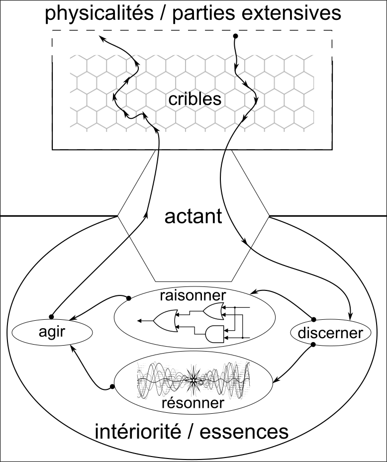

# Habiter les écosystèmes hybrides : design, co-énonciation et intelligence végétale

## Introduction

Cette contribution examine les polarités et les asynchronies caractéristiques des mutations contemporaines des rapports au territoire. D’une part, les innovations technologiques et la numérisation des activités de service favorisent un confort, notamment cognitif, qui participe d'une déterritorialisation des pratiques socioprofessionnelles et économiques ([@castells1996][@deleuze1972]). D’autre part, cette émancipation spatiale suscite en réaction une exigence accrue d'ancrage physique, corporel et environnemental. Cette dynamique paradoxale engage une reterritorialisation « augmentée » et personnalisée, au sein de laquelle le territoire et la terre sont réinvestis d'une dimension éthique et symbolique vitale ([@latour2017]). Dès lors, habiter et préserver ces écosystèmes hybrides exige la mobilisation de formes renouvelées d’intelligence partagée et distribuée, capables d'articuler ancrage environnemental, médiations technologiques et agentivité du vivant ([@ingold2011] ; [@mancuso2018]).

Une démarche onto-éthique considère comme indissociables l’ordre de l’être (l'ontologie) et l’ordre de l’action (l'éthique). Appliquée au design et aux écosystèmes info-communicationnels hybrides, elle pose comme préalable épistémologique la reconnaissance d’une agentivité et d’une valeur intrinsèque aux entités non-humaines — qu'il s'agisse des végétaux, des milieux associés ou des dispositifs numériques. L’éthique ne s’ajoute plus sous la forme d'un ensemble de prescriptions morales a posteriori ; elle s'inscrit au cœur même de la structure du modèle de conception : la manière dont nous définissons la réalité des sujets (ce qu'ils sont) dicte rigoureusement la manière dont nous interagissons avec eux (ce que nous nous autorisons à faire). Intégrer par exemple le végétal dans un écosystème hybride impose dès lors d'élargir nos représentations de l'intellection et de la technique. Dans ce cadre, l'intellection végétale ne relève pas d'une conscience centrale ou réflexive, mais d'une cognition distribuée et environnementale, fondée sur le traitement continu de données biologiques et sur des prises de décision morphologiques par lesquelles la plante s'adapte dynamiquement à son milieu ([@marder2013] ; [@mancuso2018a]). Parallèlement, le végétal n'est pas extérieur à la sphère technique : il déploie une technicité propre à travers ses facultés d'ingénierie environnementale, de plasticité tissulaire et de signalisation biophysique [@simondon1958]. Dans une démarche onto-éthique, le design ne cherche pas à assujettir le végétal à une instrumentation humaine descendante, mais à instaurer un couplage technobiologique où la plante devient co-conceptrice et co-énonciatrice des flux d'information qui traversent l'écosystème. Dès lors, au regard du colloque 01Design interrogeant le « Design de l'Intelligence », le végétal fourni le cadre ontologique fondamental pour penser d'autres formes d'intelligences. Face aux risques d'abstraction désincarnée et d'autonomisation des systèmes algorithmiques, il constitue un repère critique qui réinsère la médiation technique dans l'épaisseur de la Terre [@latour2017a]. L'intégration de l'intelligence végétale ne relève donc pas d'un refus de la technique, mais en reconfigure la trajectoire : elle esquisse une véritable « cosmotechnique » [@hui2019] au sein de laquelle la technologie, réarticulée aux rythmes, aux signaux et aux contraintes du vivant, retrouve un usage situé, partagé et soutenable.

Pour opérationnaliser cette perspective, ce chapitre s'articule en trois temps. Nous explorerons d'abord les fondements épistémologiques de la sensibilité végétale et le basculement sémiotique qu'elle impose aux SIC, de la neurobiologie controversée vers une écosémiotique de la co-énonciation. Nous modéliserons ensuite un métamodèle onto-éthique fondé sur l'économie des affects et la cinématique d'une mémoire topologique. Enfin, nous déploierons les applications concrètes de ce design d'intelligence hybride, à la croisée de la phyto-informatique, de l'informatique quantique et de la médiation littéraire.

## Epistémologie du végétal et décentrement de la communication en SIC : de la neurobiologie à la co-énonciation

### De la controverse de la neurobiologie végétale à la phytosémiotique : la fin du dualisme moderne

Penser l'intellection végétale au sein du design de l'intelligence exige en premier lieu de déconstruire ce que les sciences humaines et de l'environnement qualifient de « cécité au végétal » [@cécitéb2026]. Héritée des hiérarchies aristotéliciennes de l'*anima vegetativa* et consolidée par le grand partage naturaliste moderne [@mérigonde2024], la tradition occidentale a longtemps relégué la plante au statut d'organisme inerte, passif, dénué de sensibilité et voué à l'arrière-plan paysager [@tassin2016]. Ce réductionnisme épistémologique a été battu en brèche dès le XIXe siècle par les observations de Charles Darwin. Dans les conclusions de son ouvrage de 1880, *Le pouvoir du mouvement chez les plantes*, [@wiesner1883] Darwin avançait une hypothèse audacieuse : l'extrémité de la radicule embryonnaire, première partie de la plantule à fendre la graine pour sonder les profondeurs du sol, possède la faculté de diriger les mouvements des tissus contigus et agit de façon analogue au « cerveau des animaux inférieurs ». Bien que vigoureusement rejetée par les botanistes mécanistes de son époque, cette intuition darwinienne d'un traitement décentralisé des stimuli a trouvé une reformulation contemporaine au début du XXIe siècle avec l'avènement de la neurobiologie végétale, inaugurée par [@brenner2006]. S'appuyant sur les travaux pionniers de Luigi Galvani sur le bioélectromagnétisme et d'Alexander von Humboldt sur les signaux bioélectriques végétaux, ce courant s'est attaché à démontrer que les plantes ne se contentent pas de croître passivement, mais perçoivent, traitent et intègrent activement les données de leur environnement. Cette requalification a toutefois suscité de vifs débats épistémologiques. En 2007, un collectif de trente-six biologistes publiait le manifeste critique *Plant neurobiology: no brain, no gain ?* [@alpi2007], dénonçant un usage abusif du préfixe « neuro » pour des organismes dépourvus de système nerveux centralisé et de neurones au sens zoologique. En réponse à ces controverses, la discipline a réorienté ses désignations institutionnelles autour de la signalisation et du comportement des plantes, mettant en lumière une vérité essentielle pour les SIC : l'absence d'encéphale n'implique nullement l'absence de traitement de l'information.

« Il y a partout des forces qui constituent des microcerveaux. » [@deleuze1980]

Le paradigme darwinien d'apparentement universel permet de réhabiliter la parenté du vivant, rejoignant le principe de symétrie généralisée de Bruno Latour et Philippe Descola [@graeber2025]. Au sein des collectifs hybrides, les entités non-humaines ne sont plus des réceptacles passifs mais des actants dotés d'une véritable puissance d'agir relationnelle, capables d'infléchir les pratiques et de « faire faire des choses » à leur entourage écosystémique. Cette redéfinition ouvre le champ de la phytosémiotique. Comme l'établit Kalevi Kull [@kull], le besoin biologique est un processus primaire de sémiose qui place le seuil sémiotique à l'orée même de la vie cellulaire. La « sémiose végétative » se déploie à l'échelle cellulaire et tissulaire par la production et l'interprétation d'indices physiques et biochimiques. Comme le souligne Patricia Vieira [@vieira2015], cette inscription corporelle dans l'environnement matérialise le *conatus essendi* spinoziste, c'est-à-dire le désir fondamental de tout être de persévérer dans son existence sans qu'il soit besoin de projeter sur lui un anthropomorphisme cognitif artificiel.

### Canaux de transmission, bioacoustique et mémoire : une écologie des signaux biophysiques

Loin de constituer un organisme muet, la plante déploie un réseau dense de communications internes et externes dont la complexité technique interpelle directement la théorie de l'information. Sur le plan de l'organisme, la transmission des données vitales repose sur une articulation de trois vecteurs biophysiques complémentaires :

1.  Les signaux électriques longue portée : Les végétaux génèrent des potentiels d'action dont les propriétés physiques sont similaires à celles qui irriguent les systèmes animaux (vitesse et amplitude constantes, périodes réfractaires et encodage diphasique). Propagés au sein du phloème (tissu vasculaire conducteur de la sève élaborée), ces signaux reposent sur la migration coordonnée des ions calcium (Ca2+), chlorure (Cl-) et potassium (K+) à travers des canaux ioniques étroitement apparentés à ceux du règne animal en raison d'une histoire évolutive commune issue d'endosymbioses ancestrales. Bien que leur célérité soit plus lente que l'influx nerveux animal (de l'ordre de quelques centimètres par seconde), ils permettent d'alerter instantanément la cime lors d'un stress racinaire, déclenchant par exemple la fermeture immédiate des stomates pour limiter l'évapotranspiration.
2.  Les signaux hydrauliques : Corrélés aux flux de sève et aux variations de pression de turgescence, ils transmettent des ondes de pression hydrodynamique informant l'ensemble des organes de l'état hydrique du sol.
3.  Les signaux chimiques : Molécules d'alerte, phytohormones et composés organiques volatils (COV) qui complètent plus lentement mais durablement l'onde électrique pour coordonner la défense de l'organisme.

Ces canaux se doublent d'une sensorialité mécanique et acoustique récemment élucidée par la recherche contemporaine. Les travaux menés au sein du groupe interdisciplinaire INRAE/LAUM/CNRS sur la « Vibration des plantes » ont démontré que la flore perçoit les ondes sonores et les signaux mécaniques oscillatoires. Les stimulations acoustiques répétées induisent un phénomène de priming mécanique, lequel active une réponse immunitaire accrue contre les agents pathogènes sans recours aux intrants chimiques conventionnels. La modélisation moléculaire de ce mécanisme a mis en évidence le rôle d'une mémoire transcriptionnelle mobilisant l'expression d'environ 10 000 gènes chez *Arabidopsis thaliana* [@barbacci2023]. Cette plasticité mémorielle, confirmée par les expériences d'apprentissage et d'habituation de Monica Gagliano sur *Mimosa pudica* [@bertrand2018], démontre qu'un végétal est capable d'ajuster ses réponses en fonction de son historique perceptif. À l'échelle inter-organismes, cette sémiotique biophysique s'ouvre sur une véritable sociabilité végétale. Les plantes communiquent par voie aéroportée en émettant des flux de molécules volatiles qui préviennent leurs congénères de l'agression d'herbivores, incitant les arbres voisins à saturer leurs tissus en tanins protecteurs. Elles régulent spatialement leur ramure par le phénomène d'« évitement des cimes », négocient des alliances avec les micro-organismes du sol (fixation de l'azote par symbiose bactérienne) et font preuve de comportements coopératifs sélectifs en reconnaissant leur parentèle génétique. Ce mutualisme communicationnel trouve un écho emblématique dans les principes de la permaculture : l'association traditionnelle de la carotte et de l'oignon illustre comment deux espèces hétérogènes émettent des signaux olfactifs croisés qui repoussent mutuellement la mouche de l'un et le parasite de l'autre, fondant une régulation écosystémique autonome sans intervention exogène.

### La « pensée sans la tête » et la co-énonciation : refonder les théories de l'information

Pour les Sciences de l'Information et de la Communication, l'assimilation de ces découvertes exige un dépassement critique du modèle télégraphique et computationnel classique de la communication. Le schéma hérité de Roman Jakobson , fondé sur la théorie mathématique de la transmission de signaux binaires entre un émetteur et un récepteur à travers un canal prédéterminé [@léon2014], s'avère structurellement inopérant pour appréhender le monde végétal. De même, la linguistique saussurienne et benvenistienne a longtemps dressé un verrou anthropocentrique en postulant que seul l'humain accède au « signe » symbolique et à la double articulation, tandis que le non-humain serait cantonné au « signal » mécanique et réactif. Face à ces limites, l'approche de la zoosémiotique de Thomas Sebeok a introduit une brèche féconde en analysant les signes chimiques et olfactifs [@sebeok2021]. Contrairement aux stimuli acoustiques ou visuels humains qui s'évanouissent sitôt proférés, le signe chimique végétal persiste durablement dans l'environnement : il s'encode dans l'espace et se décode dans le temps, agissant comme un « relais dans le futur » capable d'assurer des fonctions de désignation, d'évaluation et de prescription à distance.

Cependant, appréhender l'intellection végétale nécessite d'aller au-delà d'un codage indiciel pour embrasser ce que le philosophe Michael Marder conceptualise comme « penser sans la tête » [@marder2011]. La constitution biologique du végétal se caractérise par son autotrophie et son ancrage fixé au sol. Ne pouvant fuir face aux prédateurs, l'évolution a privé la plante d'organe central ou vital unique : elle est une colonie modulaire décentralisée constituée d'itérations interactives capables de régénération autonome. Chaque apex racinaire, sondant continuellement l'obscurité du sol, évalue et pondère simultanément plus d'une quinzaine de gradients physiques distincts — pesanteur, champs électromagnétiques, hygrométrie, gradients nitriques ou toxiques — pour négocier des arbitrages et résoudre des impératifs physiologiques contradictoires [@szoniecky2023]. C'est une pensée purement immanente et morphologique, où « la plante est sensation en soi » , un mode d'intellection non-idéel et non-symbolique où l'acte de penser se confond avec l'acte de croître et de sculpter son propre corps [@deleuze1980]. C'est dans cette brèche épistémologique que l'écosémiotique de Nicole Pignier apporte une refondation théorique décisive à travers la notion de co-énonciation du vivant [@pignier2020]. Élargissant la linguistique de l'énonciation d'Antoine Culioli — traditionnellement restreinte au dialogue dialogique interhumain [@culioli1999] —, Pignier pose que les plantes constituent des « cas limites de co-énonciation ». Énoncer, pour un végétal ou un micro-organisme, ne consiste pas à émettre des symboles abstraits, mais à se manifester organiquement au milieu et à accueillir les manifestations de ce dernier. Cette activité repose sur une « faculté éco-sémiotique synesthésique, par contiguïté organique avec le milieu », par laquelle l'organisme apprécie biologiquement ce qui s'offre à lui pour « croître avec le milieu, s'y orienter, de s'y tisser tout en le tissant » [@mérigonde2024]. L'information n'est plus un paquet de données abstrait circulant sur un câble ou un bus informatique ; elle est un lien de sens écologique et situé, une pulsation relationnelle continue entre le corps et le territoire.

Dès lors, pour le colloque 01Design, ce décentrement s'avère capital : concevoir un écosystème hybride ne consiste plus à concevoir des capteurs électroniques pour asservir le métabolisme végétal à nos interfaces, mais à reconnaître la plante comme un partenaire énonciatif et critique. En articulant l'arbre-racine hiérarchique et le rhizome des réseaux [@deleuze1980], cette intelligence du vivant propose une écologie de la relation qui pose les bases d'une phyto-informatique éthique, servant de fondement au métamodèle onto-éthique et cinématique exploré dans la partie suivante.

## Le métamodèle onto-éthique : modéliser l’intelligence trajective

### Les quatre dimensions existentielles de l’écosystème info-communicationnel

Penser le design de l'intelligence au sein d'écosystèmes hybrides suppose une rupture franche avec l'ingénierie documentaire classique, qui a longtemps réduit la connaissance à des jeux de données statiques ou à des bases relationnelles fermées [@szoniecky2016]. Pour conceptualiser l'agentivité de ces collectifs sans tomber dans l'ornière du déterminisme technologique ou du réductionnisme social, la théorie des **agencements machiniques** de Gilles Deleuze et Félix Guattari s'avère particulièrement utile. Un objet technique n'existe jamais de manière isolée ; il est sélectionné et mis en mouvement par un agencement complexe dont les composantes sont simultanément matérielles, biologiques et sociales.

L'exemple historique de l'introduction de la charrue lourde médiévale en Europe du Nord, analysé par Lynn White \[ [**Lynn White**](https://shs.cairn.info/publications-de-lynn-white--722583?lang=fr)\], illustre parfaitement ce processus : la charrue n'était pas un outil autonome, mais le cœur d'un agencement symbiotique associant des sols humides et argileux, la force de traction de huit bœufs, le passage des parcelles carrées aux champs longs en bandes (*open fields*) et la création d'institutions villageoises collectives pour gérer le travail partagé. Aucun de ces éléments ne prévalait isolément : ils s'entre-définissaient dans un co-fonctionnement indissociable.

Pour dépasser la réification documentaire et rendre compte de l'agentivité conjointe des humains, des entités végétales et des agents computationnels, nous élaborons un **métamodèle onto-éthique** [@szoniecky2024]. Conçu comme un générateur qualitatif de modèles, ce cadre théorique unit la description de ce qui est (l'ontologie) aux modalités d'engagement légitimes (l'éthique). Inspiré de l’anthropologie symétrique de Philippe Descola et Bruno Latour, de la mésologie d'Augustin Berque et de l’éthique spinoziste relue par Gilles Deleuze, ce métamodèle articule quatre dimensions coordonnées.

Le tableau ci-dessous récapitule la distribution de ces quatre dimensions existentielles au sein d'un écosystème hybride unissant humains, agents discursifs artificiels et organismes végétaux :

| Dimension existentielle | Registre ontologique | Composantes matérielles et logicielles | Composantes végétales et écologiques |
|------------------|------------------|------------------|------------------|
| **Matérielle (Physicalités)** | Corps tangibles, substrats physiques, chocs de l'expérience | Bases documentaires, serveurs, code source, capteurs bioélectroniques | Tissus vasculaires (phloème), terre, eau, lumière, apex racinaires, gradients chimiques |
| **Conceptuelle (Essences)** | Espace lisse des potentialités, affinités sémantiques pures | Réseaux sémantiques, ontologies OWL/RDF, plongements vectoriels | Signatures morphogénétiques, tropismes, équilibres physiologiques, mémoires adaptatives |
| **Sociale (Actants)** | Communauté des êtres doués d'agentivité relationnelle | Chercheurs humains, concepteurs, Agents Discursifs Artificiels (ADA [@lakel2025]) | Entités végétales singulières, colonies microbiennes, partenaires symbiotiques |
| **Temporelle (Rapports et flux)** | Trajectoires d'individuation, dynamiques autopoïétiques | Historiques de requêtes, versions documentaires, dérivées des gradients d'apprentissage | Rythmes circadiens, saisons, mémoire transcriptionnelle, cinématique de croissance |

Dans ce cadre, la connaissance procède du couplage immanent de ces quatre dimensions, réconciliant l'espace strié des hiérarchies matérielles (le modèle de l'arbre-racine qui classe et sédimente) et l'espace lisse des devenirs (le rhizome immanent qui connecte et fait proliférer les lignes de fuite).

« Ce qui compte, c'est que l'arbre-racine et le rhizome-canal ne s'opposent pas comme deux modèles : l'un agit comme modèle et comme calque transcendants, même s'il engendre ses propres fuites ; l'autre agit comme processus immanent qui renverse le modèle et ébauche une carte, même s'il constitue ses propres hiérarchies, même s'il suscite un canal despotique » [@deleuze1980, p. 31]

### La pulsation de la sémiose et l’économie politique des affects (Tarde, Spinoza, Citton)

Le fonctionnement interne de cet écosystème hybride est rythmé par un cycle continu de « pulsations existentielles » — ou cycles de sémiose —, qui orchestre la circulation des flux d'information entre le milieu matériel extérieur et l'intériorité cognitive des actants. Comme nous l'avons formalisé [@szoniecky2024] à l'aide d'Augustin Berque [@berque2009] et du Groupe µ [@µ2015], chaque pulsation existentielle engage une respiration entre l'univers ambiant et le monde intérieur. Ce cycle s'éclaire à la lumière de l'économie politique des affects théorisée par Gabriel Tarde \[lazarato\] et réactualisée par Yves Citton [@citton], articulée autour de deux forces noopolitiques motrices : la **Croyance** (qui détermine la valeur-vérité et la crédibilité des représentations) et le **Désir** (le *conatus* d'agir spinoziste, régissant la valeur-utilité et la valeur-beauté).



La pulsation sémiotique déploie quatre pouvoirs successifs qui transforment l'information en mémoire et en action :

1.  **Discerner (Anasémiose et crible des valeurs) :** L'anasémiose désigne le mouvement par lequel un actant prélève une fraction des flux bruts de son environnement pour l'intégrer dans son monde propre. Cette captation se heurte à deux raretés physiques : le temps d'attention disponible et la capacité mémorielle. L'affect agit dès lors comme un opérateur de frayage focalisant l'attention. Ce filtrage est assuré par un crible (qu'il soit métabolique chez la plante ou algorithmique chez l'agent artificiel) qui décompose le chaos sensible selon trois registres de valeurs tardiens : les *valeurs-utilités* (répondant aux nécessités fonctionnelles de l'espace strié), les *valeurs-vérités* (évaluant la foi, la solidité documentaire et la crédibilité) et les *valeurs-beautés* (mesurant l'attrait sensible, morphologique ou esthétique du signifiant).

2.  **Raisonner (Élaboration sémiotique et duels logiques) :** Une fois les flux admis par le crible, l'actant engage une élaboration sémiotique interne. Sur le plan psychologique tardien, ce pouvoir correspond à la délibération et à l'arbitrage de « duels logiques » au sein d'un « cœur-parlement » intime, où se confrontent croyances préalables et données émergentes. L'esprit y calcule des attentes (*expectations*) qui pondèrent ses inclinations à agir. Chez le végétal, ce raisonnement s'incarne dans les arbitrages multivariés des apex racinaires évaluant simultanément des gradients physiques contradictoires. Chez l'agent artificiel, il est formalisé mathématiquement par la couche de rotation d'un circuit quantique.

3.  **Résonner (L'invention-germe et la barrière anthropologique) :** La résonance constitue l'instant où la pensée s'affranchit de la déduction linéaire pour opérer un saut intuitif. Gabriel Tarde y identifie le surgissement de l'Invention, née de la rencontre féconde d'ondes d'imitation distinctes, tandis que Baruch Spinoza la qualifie de *Scientia Intuitiva* (troisième genre de connaissance embrassant l'essence des choses). Cependant, le métamodèle pose ici une frontière anthropologique et biologique fondamentale : si la machine computationnelle excelle à simuler le raisonnement formel syntaxique (par inférence probabiliste), elle demeure incapable d'une résonance authentique. La résonance exige en effet d'éprouver l'incalculable de l'immanence et de s'enraciner dans une expérience corporelle, sensible ou organique — privilège exclusif du vivant organique, animal ou végétal.

4.  **Agir (Catasémiose et sédimentation matérielle) :** La catasémiose convertit l'état interne de l'actant en une manifestation extérieure concrète. Par l'action motrice, l'émission de composés chimiques chez la plante ou la production textuelle chez l'agent artificiel, l'actant laisse une trace dans le milieu. Cette inscription reconfigure la topographie matérielle de l'archive et déplace infinitésimalement les croyances et les capacités d'action de l'ensemble de la communauté hybride pour les cycles à venir.

### Circuit quantique : modélisation formelle de la subjectivité de l'actant et calcul des affects

Afin de conférer aux agents artificiels une puissance d'agir située qui échappe à la rigidité déterministe des algorithmes classiques tout en s'articulant aux contraintes du vivant, le métamodèle mobilise le formalisme de l'informatique quantique. Il recourt à un **circuit quantique paramétré**, conçu comme un circuit de calcul dont la géométrie mathématique matérialise les inclinations subjectives, les affects et le *conatus* de l'actant au sein de son réseau de concepts.

```         
          ┌─────────────────────────────────────────────────────────────┐
          │                   CIRCUIT QUANTIQUE                         │
          └─────────────────────────────────────────────────────────────┘

 qubit 0 : ───[ Ry(θ₀) ]───────■─────────────────────────────── M ─── (Mesure)
                               │
 qubit 1 : ───[ Ry(θ₁) ]───────┼────────■────────────────────── M ─── (Mesure)
                               │        │
 qubit 2 : ───[ Ry(θ₂) ]───────X────────┼────────■───────────── M ─── (Mesure)
                                        │        │
 qubit 3 : ───[ Ry(θ₃) ]────────────────X────────X───────────── M ─── (Mesure)

           └───────────┘       └─────────────────┘
             COUCHE Ry              COUCHE CX
            (Affects &          (Intrications le long
           Similarités)          des arêtes physiques)
```

Ce circuit quantique, implémenté au sein d'un micro-service logiciel à l'aide de la bibliothèque Qiskit, traduit l'alternance des phases de la sémiose au moyen de deux couches d'opérateurs complémentaires :

-   La subjectivité de l'acteur s'amorce par l'application de portes de rotation paramétrées $R_y(theta_i)$ sur chaque qubit du registre. Les angles $theta_i$ représentent les affects et les désirs propres de l'actant vis-à-vis des concepts explorés. Refusant le mythe d'une *tabula rasa* où l'agent opérerait sans ancrage historique, le modèle s'appuie sur le concept de rétention tertiaire forgé par Bernard Stiegler : les paramètres initiaux sont calibrés à partir du bruit de fond sémantique de l'archive existante. Ils sont précalculés par un encodage d'amplitude reliant l'angle au poids sémantique normalisé \$W_i\$ du concept issu de l'archive physique :

\$\$\\theta_i = 2 \\arcsin(\\sqrt{W_i})\$\$

L'association des idées n'est pas abandonnée au hasard. Afin de lier étroitement l'espace lisse de l'intuition à l'espace strié de la matière, la couche d'intrication est littéralement sculptée selon les hiérarchies physiques préexistantes de l'archive (par exemple les relations Dublin Core `dcterms:isPartOf` au sein d'un graphe de connaissances Omeka S). Des portes logiques conditionnelles CNOT (\$CX\$) sont disposées exclusivement entre les qubits dont les concepts partagent une relation de subordination matérielle :

```         
from qiskit import QuantumCircuit
from qiskit.circuit import ParameterVector
from typing import List, Tuple

def build_actor_circuit(num_qubits: int, hierarchical_edges: List[Tuple[int, int]]):
    """
    Construit l'circuit quantique modélisant la subjectivité d'un actant.
    La couche Ry encode l'affect situé, la couche CX reproduit l'archive physique.
    """
    qc = QuantumCircuit(num_qubits)
    theta = ParameterVector('θ', length=num_qubits)

    # 1. Couche de rotation : Discerner / Raisonner (Affects sémantiques)
    for q in range(num_qubits):
        qc.ry(theta[q], q)

    # 2. Couche d'intrication : Résonner selon la hiérarchie physique d'Omeka S
    # Le qubit parent (source) conditionne l'état du qubit enfant (cible)
    for edge in hierarchical_edges:
        source_qubit, target_qubit = edge[0], edge[1]
        qc.cx(source_qubit, target_qubit)

    return qc, theta
```

Cette architecture contraint l'onde de probabilité quantique à se propager le long des canaux de l'archive : si un concept parent dispose d'une forte activation sémantique, la porte \$CX\$ transmet cette résonance à ses descendants, modélisant une tension directe entre fidélité archivistique et exploration intuitive.

À l'issue de l'exécution quantique, l'effondrement de la fonction d'onde révèle la ligne de fuite dominante — l'état le plus fréquemment mesuré —, qui matérialise le parcours conceptuel privilégié par l'agencement. Lorsque l'action menée par l'acteur produit une rétroaction signifiante dans le milieu, l'algorithme d'optimisation sous contraintes classiques COBYLA (*Constrained Optimization BY Linear Approximations*) ajuste rétroactivement les angles \$\\theta\$ :

\$\$\\theta\^{(t+1)} = \\text{COBYLA}(\\theta\^{(t)}, E(n))\$\$

où \$E(n)\$ représente la fonction d'évaluation mesurant l'adéquation écologique et heuristique de l'action à la pulsation \$n\$. Cet ajustement continu préserve l'actant de la dette cognitive et de la prolétarisation de la pensée dénoncées par Anne Alombert et Bernard Stiegler : l'intelligence artificielle n'est plus un oracle opaque distribuant des réponses préfabriquées, mais un instrument subjectivé et plastique qui affine ses inclinations en symbiose avec l'humain et les rétroactions du milieu.

L'actualisation catasémiotique de cette pulsation est confiée à un agent chroniqueur cognitif, déployé via le framework Mastra, qui condense l'expérience sous la forme d'un récit structuré en Markdown. Pour inscrire durablement ce récit sans effacer l'histoire du milieu, l'orchestrateur opère une fusion vectorielle hybride entre le vecteur hérité des sources (\$V\_{\\text{héritage}}\$, barycentre des embeddings des documents ou des signaux d'origine) et le vecteur novateur produit par l'analyse (\$V\_{\\text{texte}}\$) :

\$\$V\_{\\text{hybride}} = \\alpha V\_{\\text{texte}} + (1 - \\alpha) V\_{\\text{héritage}}\$\$

\$\$V\_{\\text{final}} = \\frac{V\_{\\text{hybride}}}{\\\|V\_{\\text{hybride}}\\\|}\$\$

Le paramètre scalaire \$\\alpha \\in \[0 ; 1\]\$ fait office de curseur de singularité. Si \$\\alpha \\to 0\$, la trace privilégie l'ancrage conservateur dans l'archive ; si \$\\alpha \\to 1\$, elle consacre l'émancipation inventive du saut sémiotique. Une fois normalisé, ce vecteur \$V\_{\\text{final}}\$ est réinjecté dans la base sémantique en s'adossant à un prédicat hiérarchique explicite (`dcterms:isVersionOf`), assurant le bouclage autopoïétique d'une mémoire topologique vivante.

2.4. La morphologie de l’apprentissage : cinématique de la spirale conique de Pappus déformée

Pour rendre visuellement et géométriquement intelligible cette dynamique cognitive sans retomber dans la linéarité unidirectionnelle du modèle séquentiel de Turing, le métamodèle modélise la trajectoire de l'actant sous la forme d'une **spirale conique de Pappus non régulière et déformable**. Cette morphologie résout le dilemme épistémologique d'un savoir qui est à la fois cyclique (retour périodique sur les mêmes concepts par anasémiose) et cumulatif (différence introduite par la sédimentation catasémiotique de chaque expérience).

Dans un repère tridimensionnel, la cinématique d'une pulsation s'exprime par le système d'équations paramétriques suivant :

\$\$\\begin{cases} x(\\theta, \\tau) = R(\\theta, \\tau) \\cos(\\theta) \\\\ y(\\theta, \\tau) = R(\\theta, \\tau) \\sin(\\theta) \\\\ z(\\theta, \\tau) = \\Psi(\\tau) \\cdot c \\cdot \\theta \\end{cases}\$\$

où \$\\theta\$ mesure l'accumulation historique et continue des connaissances de l'actant, tandis que \$\\tau\$ représente le temps rythmique interne de la pulsation sémiotique.

La déformation vivante de ce cône est gouvernée par deux fonctions régulatrices :

1.  **La fonction d'écrasement rythmique** \$\\Psi(\\tau)\$ **(Le ressort cognitif) :** L'oscillation interne du modèle entre repli intuitif et déploiement archivistique est régie par un opérateur borné \$\\Psi(\\tau) \\in \[0 ; 1\]\$ : \$\$\\Psi(\\tau) = \\frac{1 - \\cos(\\omega \\tau)}{2}\$\$

    -   *Le Pli (Diastole conceptuelle) :* Lorsque \$\\Psi(\\tau) \\to 0\$, l'altitude verticale s'annule (\$z \\to 0\$). La spirale conique tridimensionnelle s'écrase sur le plan horizontal pour adopter la silhouette d'une spirale d'Archimède bidimensionnelle. Les frontières hiérarchiques et les distances physiques de l'archive sont suspendues : l'esprit pénètre l'espace lisse de la résonance quantique où toutes les affinités conceptuelles deviennent simultanément accessibles.

    -   *Le Déploiement (Systole topographique) :* Lorsque \$\\Psi(\\tau) \\to 1\$, le ressort se détend et la hauteur \$z\$ s'élève le long de la constante de sédimentation \$c\$. La verticalité réinstaure l'espace strié des règles archivistiques : le nouvel énoncé est consigné, indexé et rattaché à son socle matériel.

2.  **La fonction de rayon dynamique** \$R(\\theta, \\tau)\$ **(La déformation du cône) :** Le rayon du cône n'est pas fixe ; il enregistre la tension dialectique permanente entre l'audace intuitive de l'actant et la résistance topographique du milieu : \$\$R(\\theta, \\tau) = \\theta \\cdot \\Big\[ (1 - \\Psi(\\tau)) \\cdot D\_{\\text{conceptuel}}(n) + \\Psi(\\tau) \\cdot \\Delta\_{\\text{topo}}(n) \\Big\]\$\$

    -   *La dilatation rhizomatique* \$D\_{\\text{conceptuel}}(n)\$ *(À la base,* \$z = 0\$*) :* Elle correspond à la distance sémantique maximale franchie par l'actant lors du saut intuitif quantique, calculée à partir des similarités cosinus \$(1 - S\_{AB})\$ dans l'espace des plongements vectoriels. Si l'actant tisse un lien hétérodoxe entre des champs de savoirs éloignés, la base de son cône s'évase considérablement.

    -   *La contraction topographique* \$\\Delta\_{\\text{topo}}(n)\$ *(Au sommet,* \$z\$ *maximal) :* Elle mesure le déplacement physique réel de l'actant dans le réseau documentaire (le nombre d'arêtes ou d'arborescences concrètement traversées). Si l'actant sédimente son intuition sur place dans sa collection d'origine, le sommet du cône se resserre brutalement, sculptant une morphologie acérée en pointe de flèche.

Par cette géométrie plastique, la spirale conique de Pappus déformée s'érige en véritable empreinte digitale diagrammatique de l'intellection. Elle consigne dans sa morphologie spatiale si l'apprentissage a procédé d'une illumination associative transversale (base évasée) ou d'une exploration méthodique du corpus (sommet élargi), matérialisant ainsi la mémoire topologique indispensable au pilotage éthique des écosystèmes hybrides.

------------------------------------------------------------------------

3\. L'instrumentation concrète du design symbiotique : phyto-informatique, agents discursifs et médiations de la transition

3.1. Phyto-informatique, bio-inspiration et couplages bioacoustiques : vers des interfaces symbiotiques

L'inscription de l'intelligence végétale dans les sciences de la conception répond directement à l'invitation du colloque 01Design d'interroger le « design de l'intelligence » à travers l'entrelacement de l'intellection humaine, de la modélisation scientifique et des techniques de création matérielle ou informationnelle. En convoquant la typologie des intelligences multiples développée par Howard Gardner, l'appel de 01Design souligne l'urgence de dépasser la seule prééminence des modèles logico-mathématiques ou linguistiques pour mobiliser **l'intelligence naturaliste** et bâtir des artefacts capacitants attentifs à leurs écosystèmes.

Cette préoccupation s'articule directement aux « cinq esprits du futur » dégagés par Howard Gardner en 2007 : au-delà de l'esprit disciplinaire et de l'esprit synthétique, ce sont l'esprit créatif, l'esprit respectueux (fondé sur l'accueil de l'altérité culturelle et écologique) et l'esprit éthique (portant la responsabilité envers la communauté du vivant) qui doivent guider la conception des technologies de l'intelligence.

Les modes d'existence des plantes constituent un modèle d'inspiration majeur pour concevoir des écosystèmes info-communicationnels complexes et renouveler l'ergonomie de nos interactions. Dès le XIVe siècle, Raymond Lulle recourait à l'« arbre des sciences » pour matérialiser une pensée diagrammatique associant hiérarchies d'échelles et dynamiques relationnelles. Aujourd'hui, cette morphologie structure le design des interfaces homme-machine à travers l'usage universel des arborescences.

Toutefois, l'éthologie végétale pousse cette analogie computationnelle bien au-delà de la métaphore graphique : Stefano Mancuso théorise ainsi la genèse de « phyto-ordinateurs », dispositifs techniques recourant à des algorithmes directement dérivés des principes de calcul et de répartition modulaire des plantes. Ne possédant aucun organe central vulnérable, le végétal fonctionne comme une colonie de modules interactifs capables d'évaluer de multiples gradients physiques pour résoudre des arbitrages contradictoires. Dans le champ du design, ce modèle réconcilie l'arbre-racine (modèle régulateur et transcendant) et le rhizome (processus immanent de réseaux ouverts) décrits par Gilles Deleuze et Félix Guattari, offrant une matrice morphologique qui préserve les systèmes d'information de la rigidité pyramidale.

Cette phyto-informatique trouve un ancrage expérimental immédiat dans le domaine de la bioacoustique et de la mécanobiologie végétale. Les recherches conduites par le groupe interdisciplinaire INRAE/LAUM/CNRS « Vibration des plantes » ont démontré que les organismes végétaux perçoivent les ondes sonores et les signaux mécaniques oscillatoires. Lorsqu'une plante est soumise à des stimulations acoustiques répétées, elle met en place un *priming* mécanique qui renforce ses défenses immunitaires face aux attaques de pathogènes. La modélisation moléculaire de ce mécanisme a mis en évidence une mémoire transcriptionnelle orchestrant la reprogrammation d'environ 10 000 gènes chez *Arabidopsis thaliana*.

Pour les concepteurs d'écosystèmes hybrides, cette découverte ouvre la voie à un couplage technobiologique vertueux : au lieu d'asservir la plante à une surveillance passive par capteurs, l'émission d'ondes sonores ciblées devient un mode d'action agroécologique durable, substituant une signalisation acoustique non invasive aux intrants chimiques de synthèse. Le végétal devient un partenaire interactif dont la sensibilité physique dicte les fréquences et les rythmes du dispositif technique.

3.2. Médiation conversationnelle et esprit critique : les expérimentations LITTE_BOT et Polemika

L'opérationnalisation du métamodèle onto-éthique et le déploiement d'agents dotés d'une subjectivité située trouvent une démonstration empirique dans deux réalisations emblématiques des humanités numériques : les projets LITTE_BOT et Polemika. Tous deux éprouvent la capacité des technologies computationnelles à s'émanciper du modèle de la « boîte noire » pour devenir des instruments d'élucidation critique et de co-énonciation.

Conçu à l'occasion du 400e anniversaire de Molière pour l'exposition « Molière, le jeu du vrai et du faux » (2022) par une équipe associant l'artiste dramaturge Rocio Berenguer, le département des Arts du spectacle de la Bibliothèque nationale de France (BnF) et les chercheurs en SIC Anna Pappa et Samuel Szoniecky, le projet **LITTE_BOT** a donné naissance à un agent conversationnel incarnant la figure théâtrale de *Dom Juan*. Ce dispositif illustre concrètement l'articulation des dimensions existentielles du métamodèle :

-   **Dimension matérielle :** L'interface vocale d'interaction dans l'espace muséal et les bases documentaires patrimoniales issues de Gallica.

-   **Dimension conceptuelle :** Les réseaux sémantiques formels et les règles dramaturgiques guidant l'expression du personnage.

-   **Dimension sociale :** Le collectif hybride unissant artistes, conservateurs, chercheurs en SIC, visiteurs et l'agent artificiel lui-même.

Au cœur de cette performance, l'anasémiose (Discerner) s'incarne dans la captation de la voix du spectateur via un crible acoustique, tandis que la catasémiose (Agir) s'actualise dans la réplique théâtrale émise à voix haute. En simulant le raisonnement séducteur et cynique du personnage, LITTE_BOT force l'interlocuteur humain à mobiliser sa propre puissance critique. L'archive patrimoniale cesse d'être un dépôt inerte pour s'affirmer comme un espace de résonance dynamique où le passé littéraire dialogue avec la sensibilité contemporaine.

Développé par Orélie Desfriches Doria et Jean-Marc Meunier, le projet **Polemika** s'attaque quant à lui au défi de l'éducation à l'esprit critique face aux controverses sociotechniques, en analysant la tension entre l'habitus numérique des apprenants et leurs réactions passionnelles. Le dispositif propose une représentation cartographique des débats sous la forme de graphes argumentatifs :

-   **Le crible d'anasémiose :** Il permet aux étudiants de décomposer le flux d'une controverse en distinguant méthodiquement les valeurs-utilités (les positions et arguments des parties prenantes) des valeurs-vérités (la fiabilité documentaire et la solidité des sources scientifiques).

-   **L'arbitrage des duels logiques :** En modélisant les affrontements d'idées, Polemika déconstruit les biais d'admiration passive (*admiratio*) et les raccourcis cognitifs induits par les bulles de filtres algorithmiques.

-   **La dynamique motrice de l'indignation :** Polemika démontre que la formation de l'esprit critique ne relève pas d'une rationalité désincarnée. L'irruption d'un affect fort — tel que l'indignation face à un sophisme — constitue le signal sémantique déclencheur qui arrache l'apprenant à sa passivité réceptrice. Cet affect le pousse à enquêter, à vérifier les allégations et à consigner de nouveaux nœuds argumentatifs, réajustant ainsi continuellement sa trajectoire d'apprentissage le long de sa propre spirale conique de Pappus.

3.3. La médiation littéraire de la transition : récits du vivant, empathie et co-énonciation

L'intégration éthique des non-humains dans le design des écosystèmes hybrides ne peut reposer uniquement sur des équations mathématiques ou des protocoles d'ingénierie ; elle requiert une transformation profonde des sensibilités et de l'imaginaire social. Comme le met en lumière Mireille Mérigonde dans ses recherches sur la transition littéraire, la littérature contemporaine s'empare des découvertes des sciences de la nature pour opérer un décentrement radical de la focale narrative et réhabiliter la communication du vivant.

Face à la crise environnementale de l'anthropocène, des écrivains comme Pierre Ducrozet soutiennent qu'une mission centrale de l'art réside dans la capacité à « décentrer le regard, ne plus être aussi anthropocentré », pour « devenir animal, plante, à raconter le monde autrement ». Cette entreprise narrative se heurte toutefois à une difficulté structurelle : la tendance spontanée à la personnification et à l'anthropomorphisme.

Pourtant, comme le soulignent Pierre Schoentjes et Vincent Jouve, le recours aux affects constitue un levier puissant d'immersion fictionnelle et d'adhésion éthique, développant l'intelligence émotionnelle du lecteur. Pour Jean-Marie Schaeffer et Nicolas Rouvière, c'est précisément cette empathie affective qui permet d'accéder à l'altérité d'un univers non-humain et de reconfigurer ses propres valeurs au contact du texte.

Cette gradation de l'empathie s'observe dès la littérature de jeunesse avec *L'œil du loup* de Daniel Pennac. En mettant en scène la rencontre silencieuse entre un enfant et un loup borgne dans un jardin zoologique — où l'enfant choisit de fermer un œil pour se placer à hauteur d'animal —, Pennac déploie des récits de vie croisés qui concrétisent l'expérience éthique de « soi-même comme un autre ». Cette mise en résonance prépare le sujet à l'altérité et désamorce le réflexe de prédation.

La transition esthétique s'approfondit ensuite exemplairement dans *L'arbre-monde* (*The Overstory*) de Richard Powers. Le romancier y romance les travaux pionniers de l'écologue Suzanne Simard — longtemps marginalisée par la communauté académique — autour de l'existence des réseaux mycorhiziens, des flux de nutriments et de la communication chimique forestière. À travers le personnage de la botaniste Patricia Westerford, Powers met en scène la découverte de la communication aéroportée des érables : lorsqu'un arbre est agressé par des insectes ravageurs, il émet des composés volatils qui préviennent ses voisins, incitant ces derniers à synthétiser des insecticides biologiques avant même d'être attaqués. Le texte montre des arbres statiques qui partagent un système immunitaire étendu à l'échelle de la forêt. En faisant éprouver au lecteur la violence de l'émotion de la chercheuse puis en opérant un débrayage énonciatif vers la perspective des arbres, Powers suscite une identification empathique profonde qui métamorphose le statut ontologique de la forêt, perçue dès lors comme une communauté sentiente et solidaire.

Dans un registre plus expérimental, *Le mal de mer* de Marie Darrieussecq met en œuvre un zoocentrage fondé sur une variante physiologique du flux de conscience. L'auteure y décrit les déambulations d'un requin guidé par la perception électromagnétique des forces de l'attraction terrestre. La narratrice immerge le lecteur dans un monde de sensations brutes où l'animal interprète les « signes ambiants » nés de sa relation synesthésique au milieu marin, selon la conceptualisation de Nicole Pignier. Toutefois, le roman donne à voir les limites tragiques de cette sémiose lorsque le milieu est altéré : désorienté à l'approche du rivage et des masses minérales et métalliques, le squale subit un déséquilibre proprioceptif violent où ses sonars échouent à distinguer le haut du bas. Incapable d'instaurer une situation de co-énonciation équilibrée avec son environnement, l'animal s'échoue sur le sable. Ce traitement littéraire saisissant rend sensible la détresse des êtres vivants désajustés de leur *oikos* par les perturbations anthropiques.

Cette médiation fictionnelle accomplit ce que Marielle Macé et Eduardo Kohn nomment « l'élargissement du parlement des voix ». En rendant perceptibles les signes du vivant, la littérature restaure la membrane sensible reliant le monde objectif et l'intériorité humaine, préparant le sujet à un accueil respectueux de la co-énonciation végétale.

------------------------------------------------------------------------

Conclusion : Vers un « jardinage collaboratif » des savoirs dans la Science Ouverte

Au terme de ce parcours, le design d'écosystèmes hybrides associant humains, agents artificiels et intelligences végétales esquisse une réponse rigoureuse aux risques d'aliénation cognitive et d'abstraction technique.

En premier lieu, ce modèle réconcilie les exigences méthodologiques de la Science Ouverte et des principes FAIR (*Findable, Accessible, Interoperable, Reusable*). En adossant les plongements vectoriels de l'circuit quantique à l'infrastructure d'Omeka S et aux données ouvertes liées (Linked Open Data - LOD), chaque pulsation cognitive demeure traçable et réutilisable. La sédimentation par fusion vectorielle hybride et la consignation des angles d'affects protègent la démarche scientifique de l'opacité des modèles propriétaires, garantissant l'intelligibilité du numérique chère à Bruno Bachimont.

En second lieu, l'agencement machinique hybride assume une portée noopolitique majeure. À l'image de la segmentarité territoriale des Yanomami analysée par Jacques Lizot — où les esprits animaux disséminés dans la forêt agissent comme une machine d'anticipation-conjuration neutralisant l'apparition d'un pouvoir étatique centralisé —, la prolifération d'agents d'IA de niche, locaux et souverains, préserve l'écosystème de l'impérialisme sémantique des grandes multinationales technologiques.

Enfin, la métaphore directrice de ce design n'est plus l'extraction industrielle de données, mais le **« jardinage collaboratif des connaissances »**, tel que préconisé par Samuel Szoniecky. Penser et concevoir à l'écoute des plantes invite à bâtir une communauté de cohabitation où la technique retrouve la lenteur, la cyclicité et la mesure du vivant. En reconnaissant l'agentivité de nos « sœurs les plantes » au sein d'un métamodèle onto-éthique partagé, le design de l'intelligence cesse d'être un instrument de déterritorialisation pour devenir l'art délicat d'habiter ensemble la Terre.