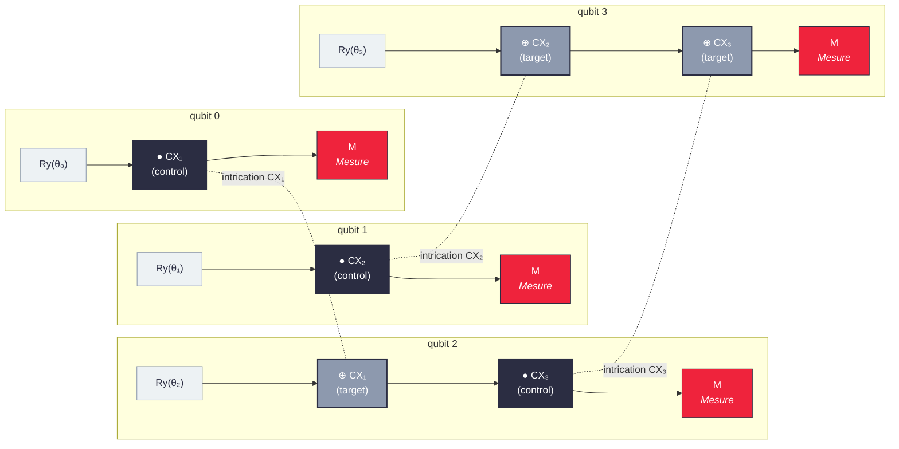
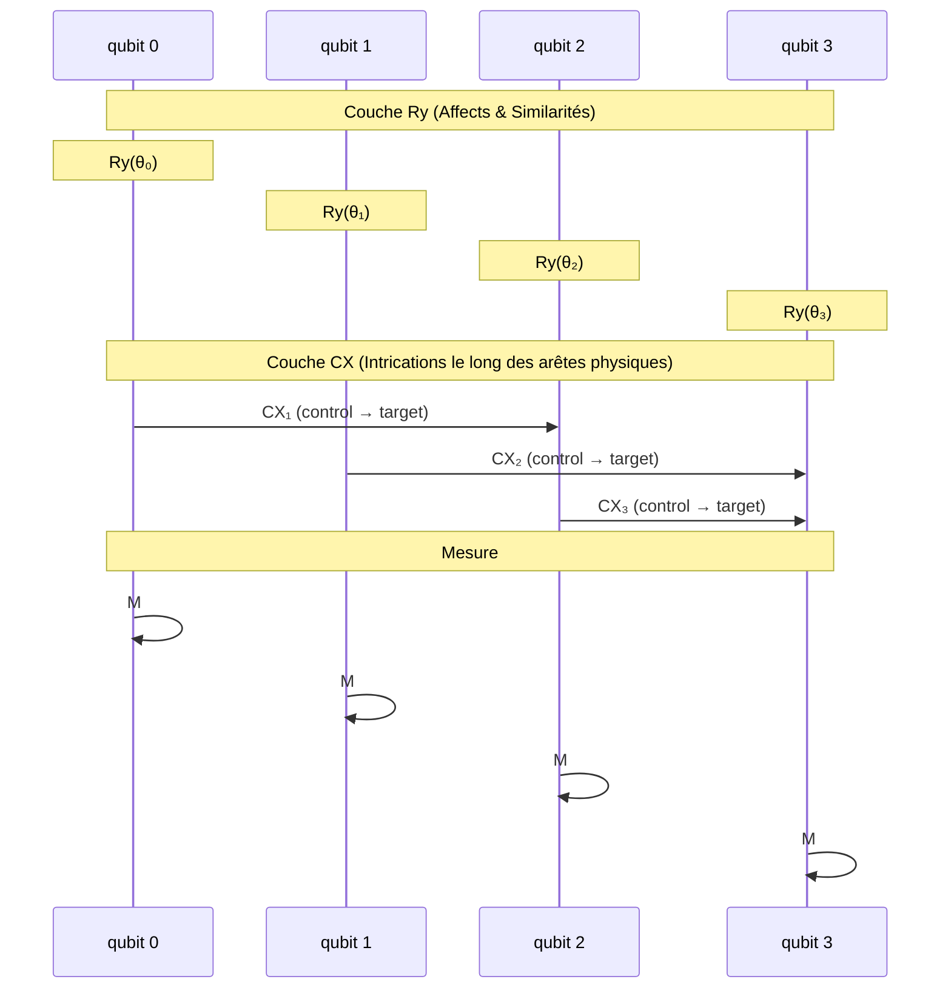

# Circuit quantique

**Légende :**
- **Couche Ry** — rotations paramétrées `Ry(θᵢ)` par qubit (encodent affects & similarités).
- **Couche CX** — intrications (`●` control → `⊕` target) le long des arêtes physiques : CX₁(0→2), CX₂(1→3), CX₃(2→3).
- **Mesure** — lecture finale `M` de chaque qubit.

## Autre proposition — sequenceDiagram

